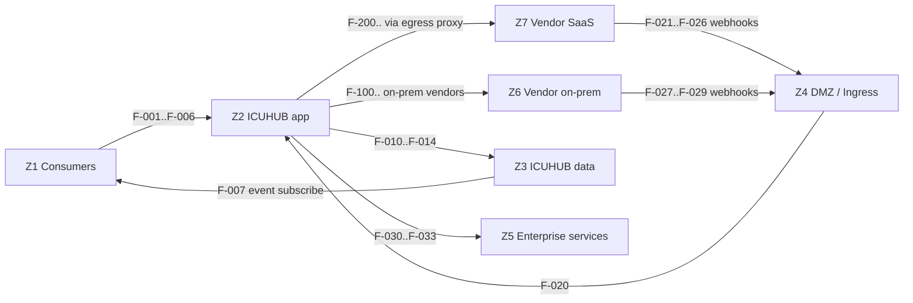

# ICUHUB -- Communication Matrix

| Field | Value |
|---|---|
| Document | ICUHUB Communication Matrix (network flows) |
| Status | Draft v0.1 |
| Date | 2026-11-05 |
| Related | `BRD.md`, `HLD.md` |

Purpose: every network flow ICUHUB needs, in a form usable for firewall / NetworkPolicy
change requests. Each flow has an ID (`F-xxx`) referenced from reviews and tickets.

Conventions:
- **Direction** is from the initiator (source) to the listener (destination). Return
  traffic on the same connection is implied and not listed.
- **Ports** are ICUHUB defaults or vendor defaults. Vendor defaults are marked
  *(vendor default, confirm per install)*; customers often front products with a
  reverse proxy on 443.
- Hostnames in examples are placeholders for the `acme` tenant.
- Every flow uses TLS 1.2+ unless stated otherwise. No plaintext flow is allowed in
  production except where explicitly marked as optional legacy and disabled by default.

---

## 1. Zones

| Zone | Contents |
|---|---|
| Z1 Consumer | AILA (backend, workers), posture management console, other enterprise hubs |
| Z2 ICUHUB app | `icuhub-api`, `icuhub-worker`, `icuhub-collector-*` pods (namespace `icuhub`) |
| Z3 ICUHUB data | Postgres, event backbone, secret backend |
| Z4 DMZ / Ingress | Ingress controller / OpenShift Router exposing `/hooks` (and optionally API) |
| Z5 Enterprise services | IdP, internal PKI, egress proxy, OTel collector, customer SIEM |
| Z6 Vendor on-prem | Self-hosted tools (F5 BIG-IP, Fortify SSC, Jenkins, GitLab self-managed, Jira DC, Nessus, Kubernetes/OpenShift APIs, Splunk, QRadar) |
| Z7 Vendor SaaS (internet) | GitHub.com, GitLab.com, Bitbucket Cloud, Jira Cloud, ServiceNow, CrowdStrike, Wiz, Prisma Cloud, Google SecOps / GTI, Microsoft APIs, AWS/GCP/Azure |

## 2. Consumer flows (Z1 -> Z2, Z1 -> Z3)

| ID | Source | Destination | Protocol | Port | Auth | Purpose | Example |
|---|---|---|---|---|---|---|---|
| F-001 | AILA backend / workers | icuhub-api (Service `icuhub-api.icuhub.svc`, or Route) | HTTPS (REST) | 443 (Route) / 8080 (in-cluster Service) | OIDC client-credentials JWT (`aud=icuhub`) or mTLS | Invoke operations, read actions, findings | `POST https://icuhub.acme.internal/v1/connections/con_gitlab_main/operations/open_change_request` |
| F-002 | AILA agents (through AILA MCP client) | icuhub-api `/mcp` | HTTPS (MCP Streamable HTTP) | 443 / 8080 | Same JWT / mTLS | Agent tool discovery and calls | `POST https://icuhub.acme.internal/mcp` `{"method":"tools/call","params":{"name":"f5-prod.block",...}}` |
| F-003 | Posture management console | icuhub-api | HTTPS (REST) | 443 / 8080 | JWT / mTLS | Pull findings, open tickets | `GET /v1/findings?connection=prisma-prod&class_uid=2003` |
| F-004 | Other enterprise hubs | icuhub-api | HTTPS (REST) | 443 / 8080 | JWT / mTLS | Any operation allowed by policy | `GET /v1/connections` |
| F-005 | Admin users (browser) | icuhub-api admin UI / API | HTTPS | 443 | OIDC/SAML SSO session | Manage connections, policy, approvals, audit | `https://icuhub.acme.internal/admin/approvals` |
| F-006 | Approvers (browser or consumer UI via API) | icuhub-api `/v1/approvals` | HTTPS | 443 | OIDC user token, role `icuhub_approver` | Approve / reject actions | `POST /v1/approvals/apr_01JC9/approve` |
| F-007 | AILA / posture console / other hubs (subscribers) | Apache Kafka (ADR-0005) | Kafka TLS | 9093 *(listener port is deployment-defined, confirm)* | SASL/SCRAM or mTLS | Subscribe to `icuhub.*` topics | Subscribe `icuhub.scm.change_request.opened` |

## 3. Ingress flows from vendors (Z6/Z7 -> Z4 -> Z2)

| ID | Source | Destination | Protocol | Port | Auth | Purpose | Example |
|---|---|---|---|---|---|---|---|
| F-020 | Ingress controller / OpenShift Router | icuhub-api `/hooks/*` | HTTP(S) | 8080 | n/a (signature checked by ICUHUB) | Forward webhooks to ICUHUB | `POST /hooks/con_gitlab_main` |
| F-021 | GitHub.com (webhook source IP ranges from GitHub `meta` API) | Ingress `/hooks/{connection_id}` | HTTPS | 443 | HMAC `X-Hub-Signature-256` | PR, push, check events | `POST https://hooks.icuhub.acme.com/hooks/con_github_main` |
| F-022 | GitLab.com | Ingress `/hooks/...` | HTTPS | 443 | `X-Gitlab-Token` secret | MR, push, pipeline events | `POST https://hooks.icuhub.acme.com/hooks/con_gitlab_com` |
| F-023 | Bitbucket Cloud | Ingress `/hooks/...` | HTTPS | 443 | HMAC `X-Hub-Signature` | PR, push events | `POST .../hooks/con_bitbucket` |
| F-024 | Jira Cloud | Ingress `/hooks/...` | HTTPS | 443 | Shared secret / JWT | Issue updates | `POST .../hooks/con_jira_cloud` |
| F-025 | ServiceNow | Ingress `/hooks/...` | HTTPS | 443 | Shared secret header | Incident / change updates | `POST .../hooks/con_snow` |
| F-026 | Azure DevOps | Ingress `/hooks/...` | HTTPS | 443 | Basic auth or header secret | PR, build events | `POST .../hooks/con_ado` |
| F-027 | GitLab self-managed (Z6) | Internal ingress `/hooks/...` | HTTPS | 443 | `X-Gitlab-Token` | MR, push, pipeline events | `POST https://icuhub.acme.internal/hooks/con_gitlab_main` |
| F-028 | Jenkins (Z6) | Internal ingress `/hooks/...` | HTTPS | 443 | Shared secret header | Build completed | `POST .../hooks/con_jenkins` |
| F-029 | Jira Data Center / Bitbucket Server (Z6) | Internal ingress `/hooks/...` | HTTPS | 443 | Shared secret / HMAC | Issue / PR events | `POST .../hooks/con_jira_dc` |
| F-040 | Network devices, appliances (Z6) | icuhub-collector-syslog | Syslog over TLS (RFC 5425) | 6514/TCP | mTLS (optional) | Syslog/CEF telemetry | CEF from F5 ASM to `syslog.icuhub.acme.internal:6514` |
| F-041 | Legacy devices (optional, disabled by default) | icuhub-collector-syslog | Syslog TCP / UDP plaintext | 514/TCP, 514/UDP | none | Legacy telemetry where TLS unsupported | Only on an isolated segment with explicit exception |

Separation recommendation: internet-facing webhook ingress (`hooks.icuhub.acme.com`)
exposes only `/hooks/*`; API, MCP, and admin are reachable only on the internal hostname.

## 4. Internal platform flows (Z2 -> Z3, Z2 -> Z5)

| ID | Source | Destination | Protocol | Port | Auth | Purpose | Example |
|---|---|---|---|---|---|---|---|
| F-010 | icuhub-api, icuhub-worker | Postgres | PostgreSQL (TLS) | 5432 | SCRAM-SHA-256 or client cert | State, audit, outbox | `postgresql://icuhub@pg.icuhub.svc:5432/icuhub?sslmode=verify-full` |
| F-011 | icuhub-worker (outbox relay) | Apache Kafka (ADR-0005) | Kafka TLS | 9093 | SASL/SCRAM or mTLS | Publish `icuhub.*` events from the Postgres outbox | Produce to `icuhub.finding.upserted` |
| F-012 | icuhub-worker (collectors needing a stream consumer) | Apache Kafka | Kafka TLS | 9093 | as above | Internal normalization topics for streaming collectors (action jobs and approvals use Postgres, ADR-0014) | Consume `icuhub.internal.normalize` |
| F-013 | icuhub-api, icuhub-worker | OpenBao Transit (ADR-0006) | HTTPS | 8200 *(OpenBao default, confirm)* | Kubernetes auth method (service account JWT) | Unwrap and rewrap data keys of envelope-encrypted credentials stored in Postgres | `POST https://openbao.acme.internal:8200/v1/transit/decrypt/icuhub-acme` |
| F-014 | icuhub-worker | Object storage (optional, raw payload overflow) | HTTPS (S3 API) | 443 / 9000 (MinIO) | Access key / IRSA / workload identity | Store oversized raw vendor payloads | `PUT s3://icuhub-raw/acme/...` |
| F-030 | icuhub-api | Enterprise IdP (OIDC discovery, JWKS) | HTTPS | 443 | none (public metadata) | Validate JWTs, admin SSO | `GET https://idp.acme.internal/.well-known/openid-configuration` |
| F-031 | icuhub-worker (audit exporter) | Customer SIEM | Syslog TLS / Splunk HEC / Kafka | 6514 / 8088 *(Splunk HEC vendor default)* / 9093 | mTLS / HEC token / SASL | OCSF audit export | `POST https://splunk-hec.acme.internal:8088/services/collector/event` |
| F-032 | All ICUHUB pods | OpenTelemetry collector | OTLP gRPC / HTTP | 4317 / 4318 | mTLS (optional) | Traces, metrics, logs | `otel-collector.observability.svc:4317` |
| F-033 | Prometheus | icuhub-api, icuhub-worker `/metrics` | HTTP(S) | 8080 / 9464 | NetworkPolicy restricted | Metrics scrape | `GET http://icuhub-api.icuhub.svc:8080/metrics` |
| F-034 | icuhub-worker, icuhub-api | Egress proxy (if mandated) | HTTP CONNECT | 3128 / 8080 *(proxy default, confirm)* | Proxy auth (optional) | All Z7 vendor traffic | `CONNECT api.github.com:443` |
| F-035 | Admin approvers notification (optional) | Mail relay / chat webhook via a notifier connector | SMTP STARTTLS / HTTPS | 587 / 443 | SMTP auth / webhook secret | Approval notifications | `icuhub.approval.requested` -> Teams/Slack/email |

## 5. Outbound to on-prem vendors (Z2 -> Z6)

All initiated by `icuhub-worker` (scheduled pulls, approved actions) or `icuhub-api`
(synchronous operations).

| ID | Destination | Protocol | Port | Auth | Purpose | Example |
|---|---|---|---|---|---|---|
| F-100 | F5 BIG-IP management (iControl REST) | HTTPS | 443 *(vendor default; 8443 on single-NIC BIG-IP VE)* | Token auth (`/mgmt/shared/authn/login`) or basic | List virtual servers, manage blocklists / data-groups | `GET https://bigip-dmz.acme.internal/mgmt/tm/ltm/virtual` |
| F-101 | GitLab self-managed API | HTTPS | 443 | Project/group access token, OAuth | MRs, branches, commits, pipelines | `POST https://gitlab.acme.internal/api/v4/projects/42/merge_requests` |
| F-102 | GitLab self-managed MCP (MCP-backed connector) | HTTPS (MCP) | 443 | OAuth / PAT per GitLab config | Govern GitLab MCP tools | `POST https://gitlab.acme.internal/api/v4/mcp` |
| F-103 | GitHub Enterprise Server | HTTPS | 443 | GitHub App JWT + installation token | PRs, checks, code scanning | `POST https://ghe.acme.internal/api/v3/repos/acme/orders/pulls` |
| F-104 | Bitbucket Data Center | HTTPS | 443 *(7990 vendor default)* | HTTP access token | PRs, Code Insights | `POST https://bitbucket.acme.internal/rest/api/1.0/projects/ACME/repos/orders/pull-requests` |
| F-105 | Jenkins | HTTPS | 443 *(8080 vendor default)* | API token (user) | Trigger builds, read results | `POST https://jenkins.acme.internal/job/orders-ci/buildWithParameters` |
| F-106 | Jenkins MCP plugin (MCP-backed) | HTTPS (MCP) | 443 | API token | Govern Jenkins MCP tools | `https://jenkins.acme.internal/mcp-server/...` *(path per plugin docs, confirm)* |
| F-107 | Jira Data Center | HTTPS | 443 *(8080 vendor default)* | Personal access token / OAuth | Tickets | `POST https://jira.acme.internal/rest/api/2/issue` |
| F-108 | Fortify Software Security Center (SSC) | HTTPS | 443 *(8443 common Tomcat deployment, confirm)* | SSC token (`FortifyToken`) | Pull issues, artifacts | `GET https://ssc.acme.internal/ssc/api/v1/projectVersions/12/issues` |
| F-109 | Nessus | HTTPS | 8834 *(vendor default)* | API access/secret keys (`X-ApiKeys`) | Pull scan results | `GET https://nessus.acme.internal:8834/scans/17` |
| F-110 | Tenable Security Center | HTTPS | 443 | API keys | Pull vulnerabilities | `POST https://sc.acme.internal/rest/analysis` |
| F-111 | SonarQube | HTTPS | 443 *(9000 vendor default)* | User token | Pull issues, hotspots | `GET https://sonar.acme.internal/api/issues/search?componentKeys=orders` |
| F-112 | Kubernetes API server | HTTPS | 6443 | ServiceAccount token / client cert (read-only RBAC by default) | Inventory, logs | `GET https://k8s-prod.acme.internal:6443/api/v1/namespaces/orders/pods` |
| F-113 | OpenShift API server | HTTPS | 6443 | ServiceAccount token (read-only RBAC by default) | Inventory, logs | `GET https://api.ocp.acme.internal:6443/apis/apps/v1/namespaces/orders/deployments` |
| F-114 | Kubernetes/OpenShift MCP server (MCP-backed, `containers/kubernetes-mcp-server`) | HTTPS (MCP) | per deployment (for example 8080) | Bearer / mTLS | Govern k8s MCP tools | `POST https://k8s-mcp.acme.internal/mcp` |
| F-115 | Splunk Enterprise management / REST | HTTPS | 8089 *(vendor default)* | Splunk token | Structured searches, saved searches | `POST https://splunk.acme.internal:8089/services/search/jobs` |
| F-116 | IBM QRadar | HTTPS | 443 | `SEC` token header | Offenses, AQL (structured) | `GET https://qradar.acme.internal/api/siem/offenses` |
| F-117 | Elastic / OpenSearch | HTTPS | 9200 *(vendor default)* | API key | Alerts, structured queries | `POST https://elastic.acme.internal:9200/.alerts-security.alerts-*/_search` |
| F-118 | MISP | HTTPS | 443 | `Authorization` API key | Indicator lookup | `POST https://misp.acme.internal/attributes/restSearch` |
| F-119 | OpenCTI | HTTPS (GraphQL) | 443 *(8080 vendor default)* | Bearer token | Indicator / entity lookup | `POST https://opencti.acme.internal/graphql` |
| F-120 | Cortex XSOAR (on-prem) | HTTPS | 443 | API key | Incidents, playbooks | `POST https://xsoar.acme.internal/incident` |
| F-121 | Symantec / Forcepoint DLP (on-prem) | HTTPS | 443 *(confirm per product)* | Product API credentials | DLP incidents | per product REST API |

## 6. Outbound to SaaS vendors (Z2 -> Z7, through egress proxy F-034 when mandated)

| ID | Destination | Protocol | Port | Auth | Purpose | Example |
|---|---|---|---|---|---|---|
| F-200 | `api.github.com` | HTTPS | 443 | GitHub App JWT -> installation token | PRs, reviews, checks, SARIF upload | `POST https://api.github.com/repos/acme/orders/code-scanning/sarifs` |
| F-201 | `gitlab.com` | HTTPS | 443 | Project/group token, OAuth | MRs, pipelines, security reports | `POST https://gitlab.com/api/v4/projects/42/merge_requests` |
| F-202 | `gitlab.com/api/v4/mcp` | HTTPS (MCP) | 443 | OAuth | MCP-backed GitLab | `POST https://gitlab.com/api/v4/mcp` |
| F-203 | `api.bitbucket.org` | HTTPS | 443 | Workspace/repo access token, OAuth | PRs, Code Insights reports/annotations | `PUT https://api.bitbucket.org/2.0/repositories/acme/orders/commit/9f1c2ab/reports/icuhub` |
| F-204 | `dev.azure.com` | HTTPS | 443 | PAT / Entra service principal | PRs, pipelines | `POST https://dev.azure.com/acme/orders/_apis/git/repositories/orders/pullrequests?api-version=7.1` |
| F-205 | `<site>.atlassian.net` | HTTPS | 443 | API token / OAuth 2.0 (3LO) / service account | Tickets | `POST https://acme.atlassian.net/rest/api/3/issue` |
| F-206 | `<instance>.service-now.com` | HTTPS | 443 | OAuth 2.0 / basic (service account) | Incidents, changes | `POST https://acme.service-now.com/api/now/table/incident` |
| F-207 | `www.virustotal.com` (Google Threat Intelligence API) | HTTPS | 443 | `x-apikey` | Indicator lookup (egress class `third_party_shared` for public-corpus queries) | `GET https://www.virustotal.com/api/v3/ip_addresses/203.0.113.45` |
| F-208 | Google SecOps / SOAR / SCC / GTI MCP (`google/mcp-security`, remote Google MCP endpoints) | HTTPS (MCP / Google APIs) | 443 | Google service account / workload identity | MCP-backed Google security | `https://<region>-chronicle.googleapis.com/...` *(per Google docs)* |
| F-209 | CrowdStrike Falcon API (`api.crowdstrike.com` / regional `api.us-2.crowdstrike.com`, `api.eu-1.crowdstrike.com`) | HTTPS | 443 | OAuth2 client credentials | Detections, host containment | `POST https://api.crowdstrike.com/devices/entities/devices-actions/v2?action_name=contain` |
| F-210 | Microsoft Defender XDR / Graph Security / Sentinel (`api.security.microsoft.com`, `graph.microsoft.com`, `management.azure.com`, `api.loganalytics.io`) | HTTPS | 443 | Entra ID client credentials | Alerts, incidents, KQL (structured), isolation | `POST https://api.loganalytics.io/v1/workspaces/<id>/query` |
| F-211 | `login.microsoftonline.com` | HTTPS | 443 | Client credentials | Entra token issuance for F-210 / F-204 | `POST https://login.microsoftonline.com/<tenant>/oauth2/v2.0/token` |
| F-212 | SentinelOne (`<tenant>.sentinelone.net`) | HTTPS | 443 | API token | Threats, isolation | `GET https://acme.sentinelone.net/web/api/v2.1/threats` |
| F-213 | Wiz API (`api.<region>.app.wiz.io`) and auth (`auth.app.wiz.io`) | HTTPS (GraphQL) | 443 | OAuth2 client credentials | Issues, inventory | `POST https://api.us17.app.wiz.io/graphql` |
| F-214 | Prisma Cloud API (`api.<stack>.prismacloud.io`) | HTTPS | 443 | Access key -> JWT (`/login`) | Alerts, compliance findings | `POST https://api.prismacloud.io/v2/alert` |
| F-215 | Cloudflare API (`api.cloudflare.com`) | HTTPS | 443 | API token | WAF rules, IP access rules | `POST https://api.cloudflare.com/client/v4/zones/<id>/firewall/access_rules/rules` |
| F-216 | F5 Distributed Cloud (`<tenant>.console.ves.volterra.io`) | HTTPS | 443 | API token / certificate | WAF/service policies | `POST https://acme.console.ves.volterra.io/api/config/namespaces/acme/service_policys` |
| F-217 | Mend (`saas.mend.io` / regional) | HTTPS | 443 | User key + org token | SCA findings | per Mend API |
| F-218 | Invicti / Netsparker Enterprise (`www.netsparkercloud.com` or on-prem) | HTTPS | 443 | User ID + API token (basic) | DAST findings | `GET https://www.netsparkercloud.com/api/1.0/issues/report` |
| F-219 | Snyk (`api.snyk.io`) | HTTPS | 443 | API token / service account | SCA/SAST findings | `GET https://api.snyk.io/rest/orgs/<id>/issues?version=2024-10-15` |
| F-220 | Qualys (`qualysapi.<platform>.qualys.com`) | HTTPS | 443 | Basic (API user) | VM findings | `POST https://qualysapi.qualys.com/api/2.0/fo/asset/host/vm/detection/` |
| F-221 | AWS (`sqs.<region>.amazonaws.com`, `s3.<region>.amazonaws.com`, `securityhub.<region>.amazonaws.com`, `sts.amazonaws.com`) | HTTPS | 443 | IAM role (IRSA / assume role) | CloudTrail via S3+SQS collector; Security Hub findings | `ReceiveMessage` on `https://sqs.eu-west-1.amazonaws.com/<acct>/cloudtrail-notify` |
| F-222 | GCP (`pubsub.googleapis.com`, `securitycenter.googleapis.com`, `oauth2.googleapis.com`) | HTTPS / gRPC | 443 | Service account / workload identity | Pub/Sub collector, SCC findings | `projects/acme-sec/subscriptions/icuhub-logs:pull` |
| F-223 | Azure Event Hubs (`<ns>.servicebus.windows.net`) | AMQP over TLS / AMQP over WebSockets | 5671 / 443 | Entra client credentials or SAS | Event Hubs collector | `amqps://acme-logs.servicebus.windows.net/insights-activity-logs` |
| F-224 | Okta (`<org>.okta.com`) | HTTPS | 443 | API token / OAuth service app | Identity events, user lookup | `GET https://acme.okta.com/api/v1/logs?since=...` |
| F-225 | Microsoft Purview (Graph / compliance APIs) | HTTPS | 443 | Entra client credentials | DLP alerts | via `graph.microsoft.com` security alerts |

## 7. Explicitly forbidden flows

| ID | Flow | Reason |
|---|---|---|
| X-01 | Any consumer (Z1) -> any vendor (Z6/Z7) directly for integrated vendors | Breaks BR-02/BR-03; enforced by consumer-side audit and network policy |
| X-02 | Internet -> icuhub-api `/v1`, `/mcp`, `/admin` | Only `/hooks/*` is internet-facing |
| X-03 | icuhub pods -> arbitrary internet destinations | Default-deny egress; only registered connection endpoints (allowlist generated from connections) |
| X-04 | Vendors -> Postgres / secret backend / event backbone | Data zone reachable only from Z2 (and subscribers for the backbone) |
| X-05 | Plaintext syslog (F-041) outside an isolated segment | No cleartext telemetry over shared networks |

## 8. Kubernetes / OpenShift NetworkPolicy outline

| Policy | Selects | Allows |
|---|---|---|
| `icuhub-default-deny` | all pods in `icuhub` | nothing (ingress and egress denied) |
| `icuhub-api-ingress` | `app=icuhub-api` | from ingress controller / router namespace on 8080 (F-020, F-001..F-006 via Route); from consumer namespaces (`aila`, `posture`) on 8080; from monitoring on 8080 (F-033) |
| `icuhub-collector-ingress` | `app=icuhub-collector-syslog` | from device CIDRs on 6514 (F-040) |
| `icuhub-egress-data` | api, worker | to Postgres 5432 (F-010), Kafka 9093 (F-011/F-012), OpenBao 8200 (F-013), object storage (F-014) |
| `icuhub-egress-platform` | api, worker | to IdP 443 (F-030), OTel 4317/4318 (F-032), SIEM (F-031), DNS 53/UDP+TCP to cluster DNS |
| `icuhub-egress-vendors` | worker, api | to egress proxy (F-034) or to vendor CIDRs / FQDN policies for F-100..F-121, F-200..F-225 |

FQDN-based egress (for SaaS vendors) needs either an egress proxy with an allowlist or
a CNI that supports FQDN policies; plain Kubernetes NetworkPolicy is IP/CIDR only.

## 9. Firewall request template (example rows)

| Flow ID | Source (CIDR / workload) | Destination (FQDN / CIDR) | Proto | Port | Justification | Owner |
|---|---|---|---|---|---|---|
| F-100 | `icuhub` namespace egress IPs `10.40.8.0/26` | `bigip-dmz.acme.internal` (`10.10.0.15`) | TCP | 443 | ICUHUB F5 connector: list virtual servers, approved blocklist changes | Security Engineering |
| F-109 | `10.40.8.0/26` | `nessus.acme.internal` (`10.12.3.20`) | TCP | 8834 | ICUHUB Nessus connector: pull scan results | Vulnerability Management |
| F-112 | `10.40.8.0/26` | `k8s-prod.acme.internal` (`10.20.0.10`) | TCP | 6443 | ICUHUB Kubernetes connector, read-only RBAC | Platform Team |
| F-200 | egress proxy `10.5.0.10` | `api.github.com` | TCP | 443 | ICUHUB GitHub connector: PRs, checks, SARIF | AppSec |
| F-021 | GitHub hook ranges (from `https://api.github.com/meta`, `hooks` key) | `hooks.icuhub.acme.com` (WAF/LB VIP) | TCP | 443 | Inbound GitHub webhooks to ICUHUB `/hooks/*` only | AppSec |
| F-040 | `10.10.0.0/24` (DMZ appliances) | `syslog.icuhub.acme.internal` (`10.40.8.50`) | TCP | 6514 | CEF over TLS from F5 ASM to ICUHUB collector | SOC |

## 10. End-to-end flow examples

### 10.1 GitLab MR -> AILA VR investigation -> fix MR

| Step | Flow | What happens |
|---|---|---|
| 1 | F-027 (or F-022 for gitlab.com) | GitLab sends Merge Request Hook to `/hooks/con_gitlab_main` |
| 2 | F-020 | Ingress forwards to icuhub-api; signature checked, delivery stored, 202 |
| 3 | F-010 | Delivery + outbox event committed to Postgres |
| 4 | F-011 | Relay publishes `icuhub.scm.change_request.opened` |
| 5 | F-007 | AILA subscriber receives event, starts investigation `inv_8a10` |
| 6 | F-001 | AILA reads diff files: `get_diff_files` operation |
| 7 | F-013, F-101 | ICUHUB decrypts the GitLab token (data key unwrapped through OpenBao Transit), calls GitLab API |
| 8 | F-001 | After fix passes gates, AILA calls `open_change_request` (draft) with `X-Correlation-Id: inv_8a10` |
| 9 | F-006 | Approver approves (policy `require_approval` for writes) |
| 10 | F-101 | Worker creates branch, commits patch, opens draft MR |
| 11 | F-011 -> F-007 | `icuhub.action.succeeded` delivered to AILA |
| 12 | F-031 | Audit records exported to SIEM as OCSF |

### 10.2 AILA agent blocks IP on F5

| Step | Flow | What happens |
|---|---|---|
| 1 | F-002 | Agent `tools/call f5-prod.block` via MCP |
| 2 | F-010 | Action request stored, policy -> `require_approval`, approval created |
| 3 | F-011 -> F-035 | `icuhub.approval.requested` -> notifier |
| 4 | F-006 | SOC lead approves |
| 5 | F-013, F-100 | Worker gets F5 token, adds IP to managed address list |
| 6 | F-011 -> F-007 | `icuhub.action.succeeded` with `correlation_id: inv_7f3c` |
| 7 | F-031 | Audit export |

### 10.3 Posture console pulls Prisma Cloud and Wiz findings

| Step | Flow | What happens |
|---|---|---|
| 1 | F-214, F-213 (via F-034) | Worker scheduled pulls with cursors and per-poll budget |
| 2 | F-010 | Findings normalized to OCSF (Compliance Finding 2003 / Vulnerability Finding 2002), deduped by fingerprint |
| 3 | F-011 -> F-007 | `icuhub.finding.upserted` to posture console |
| 4 | F-003 | Console backfills with `GET /v1/findings?since=...` |

### 10.4 Threat intel lookup with egress control

| Step | Flow | What happens |
|---|---|---|
| 1 | F-002 | Agent calls `gti.lookup` for an IP |
| 2 | (in-process) | Policy: operation egress class `third_party_shared` (public corpus query); tenant rule requires approval or denies for indicators tagged internal |
| 3 | F-207 (via F-034) | If allowed, worker calls GTI API with injected `x-apikey` |
| 4 | F-010, F-031 | Audit records the egress class and decision |

## 11. Port summary (ICUHUB-owned listeners)

| Listener | Port | Exposure |
|---|---|---|
| icuhub-api (REST, MCP, hooks, admin, metrics) | 8080 (container), 443 via Route/Ingress | Internal hostname for REST/MCP/admin; internet hostname for `/hooks/*` only |
| icuhub-worker metrics | 9464 | Monitoring namespace only |
| icuhub-collector-syslog | 6514/TCP (TLS); 514/TCP+UDP optional legacy, disabled by default | Device CIDRs only |

## 12. Items to confirm per installation

| Item | Why |
|---|---|
| Vendor ports where marked *(vendor default, confirm)* | Customers often change defaults or front with a reverse proxy |
| SaaS regional hostnames (CrowdStrike, Wiz, Prisma Cloud, Qualys, Mend, Google) | Depend on the customer's tenant region / stack |
| Webhook source IP ranges | Vendors publish and change them (for example GitHub `meta` API) |
| Kafka listener ports | Deployment-defined; 9093 used in this document |
| OpenBao endpoint and Transit key naming | Customer standard; one Transit key per tenant |
| Egress proxy host/port | Customer standard |
| Jenkins MCP plugin path | Confirm against plugin documentation for the installed version |
