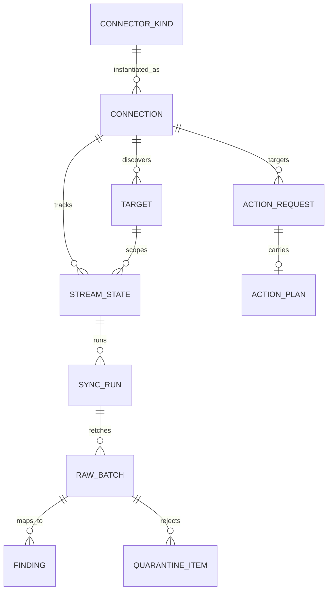
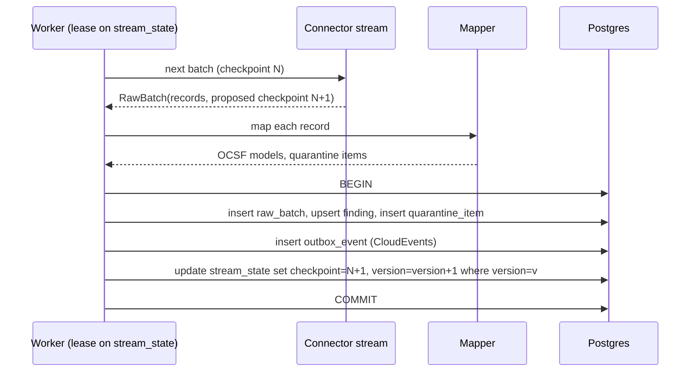
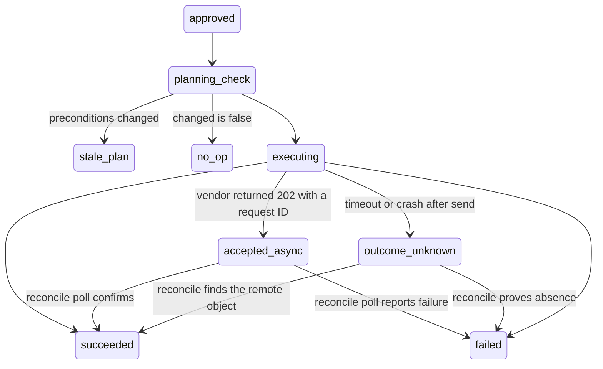

# ICUHUB -- Connector Framework

| Field | Value |
|---|---|
| Document | Connector framework design (connector kit, sync engine, action execution) |
| Status | v0.1 -- design; decisions D15..D17 closed (ADR-0017..0019) |
| Date | 2026-11-07 |
| Inputs | `PRIOR_ART.md` (lessons PA-01..PA-41, anti-patterns AP-*), `HLD.md` sections 4 to 9, `BRD.md` v0.3, ADR-0002, ADR-0005, ADR-0006, ADR-0013, ADR-0014, ADR-0016 |
| Builds in | P2 (kit), P3 (sync engine and action execution), P4 (webhooks), P5 (wave-1 connectors), P10 (scaffolds, dashboards) |

This document is ICUHUB's version of the integration model that the surveyed projects
converge on. Each design rule cites the lesson that motivates it (`PA-xx`) and the
requirement it creates (`FR-*`, appended to `BRD.md` v0.3). `HLD.md` section 5 keeps the
capability protocols; this document defines the host-facing contract around them.

---

## 1. What the survey says, in one table

| Concern | Converged answer in the survey | ICUHUB choice | Lessons |
|---|---|---|---|
| Unit of integration | One connector per vendor product, versioned, with a declared manifest | Python class + generated, committed manifest (ADR-0017) | PA-01, PA-02 |
| Isolation | First-party in-process, third-party out of process | First-party only, in-process; no third-party connector loading (ADR-0018) | PA-07 |
| Contract | Small lifecycle: spec, check, discover, read; actions separate | `check`, `discover`, streams, read operations, plan/apply actions, webhook parse | PA-09 |
| State | Host-owned per-stream checkpoint, committed after the durable write | Typed checkpoint committed in the outbox transaction | PA-12, PA-13 |
| Deletion | Only from a declared-complete snapshot, with a guard | `full` mode with completeness and removal circuit breaker | PA-15 |
| Mapping | Parse then map; golden fixtures; residue kept | Parser + versioned mapper with JMESPath extraction (ADR-0019) + `raw_data` / `unmapped` + fixture proof | PA-19..PA-22 |
| Identity | Stable source ID before hashing; separate delivery ID | Three identities; versioned fingerprint; asset references | PA-23, PA-40 |
| Writes | Plan/dry-run, idempotency, uncertain-outcome state | Plan/apply with plan hash; `outcome_unknown` state | PA-26..PA-28 |
| Secrets | References in config, decrypt at egress | `SecretRef` fields, broker injection | PA-31, PA-32 |
| Testing | Static checks, fixtures, mocked HTTP, opt-in live | Conformance suite + recorded transport + `ICUHUB_ACC` | PA-37, PA-38 |
| Lifecycle of connectors | Owners, tiers, per-capability stability, removal | Manifest fields + CI gates + deprecation policy | PA-04, PA-05 |

### 1.1 Anti-patterns ruled out

| ID | Anti-pattern (`PRIOR_ART.md` section 4) | Ruled out in section |
|---|---|---|
| AP-01 | Mutable `latest` installs | 9 (pinning) |
| AP-02 | Shared dependency space breaks other connectors | 9.1 (one reviewed lock set; kit instead of vendor SDKs) |
| AP-03 | Timestamp-only high-water marks | 5.3 (`time_id`) |
| AP-04 | State advanced before downstream commit | 5.2 |
| AP-05 | Partial report treated as complete | 5.4 |
| AP-06 | Retry queues drop history, silent disable | 5.6 |
| AP-07 | Giant mappings, unknown fields dropped | 6.1 |
| AP-08 | Mutable, organization-wide fingerprints | 6.2 |
| AP-09 | Independent mappings overwrite shared fields | 6.3 (link, do not merge) |
| AP-10 | Blind create-on-retry | 7.2 (`outcome_unknown`) |
| AP-11 | One ticket per raw notification | 7.3 |
| AP-12 | Generic retry presented as rollback | 7.2 (declared `compensate` only) |
| AP-13 | Name-based redaction as secret protection | 4, 8 (`SecretRef`) |
| AP-14 | One global rate-limit bucket | 5.5 |
| AP-15 | Live third-party APIs in required CI | 10 (live acceptance opt-in) |
| AP-16 | Generated scaffolds published unreviewed | 9 (scaffolds) |
| AP-17 | Package metadata shapes runtime; open egress | 12, NFR-03 |
| AP-18 | Failure reported as clean | 3.4, 5.4, 11 (`not_evaluated`) |

## 2. Object model



| Object | Owner | What it is | Lessons |
|---|---|---|---|
| Connector kind | Code | A registered class (`CONNECTORS` dict, ADR-0002) plus its generated manifest | PA-01 |
| Connection | Tenant admin | One configured instance: credentials (reference), base URL, settings, limits, allowed operations | PA-10, PA-32 |
| Target | Discovery + admin | A scoped object inside a connection: repository, project, application, account, feed. Has `included`, `paused`, `last_seen_at`, `missing_since` | PA-10 |
| Stream | Code | A named read unit (`issues`, `alerts`, `audit_events`) producing one OCSF class | PA-09 |
| Stream state | Host | Checkpoint, checkpoint version, mode, lease, health per `(connection, target, stream, partition)` | PA-12, PA-13 |
| Sync run | Host | One execution of one stream state: mode, completeness, counts, outcome | PA-36 |
| Raw batch | Host | The fetched page, encrypted, with digest, parser version, retention per NFR-16 | PA-21 |
| Quarantine item | Host | A record the parser or mapper rejected, with error and replay link | PA-18 |
| Action plan | Connector + host | Typed description of a write: target, diff, preconditions, idempotency key, plan hash | PA-26 |

A target is not a tenant: tenants own connections (`HLD.md` section 4); targets narrow
what a connection reads and writes.

## 3. Connector contract

### 3.1 Shape

```python
class FortifySsc(Connector):
    kind = "fortify_ssc"
    version = "0.3.0"                      # connector semver (section 9)
    sdk = ">=1,<2"                          # host SDK range the connector supports
    owner = "@icuhub/appsec-connectors"     # CODEOWNERS team
    support = "core"                        # core | community | archived
    config = FortifyConfig                  # Pydantic model; SecretRef fields are write-only
    auth = (ApiTokenAuth,)                  # strategies from the kit (FR-CON-02)

    async def check(self, ctx: CheckContext) -> HealthReport: ...
    async def discover(self, ctx: DiscoverContext) -> AsyncIterator[TargetRecord]: ...

    @stream(name="issues", ocsf_class=2002, cursor=TimeIdCursor,
            modes=("incremental", "full"), stability="beta")
    async def issues(self, ctx: StreamContext, target: Target,
                     checkpoint: TimeIdCursor | None) -> AsyncIterator[RawBatch[TimeIdCursor]]: ...

    @mapper(stream="issues", version=3)
    def map_issue(self, raw: FortifyIssue, ctx: MapContext) -> VulnerabilityFinding: ...

    @operation(name="get_issue", capability=None, classification="read",
               egress_class="vendor_tenant", input_schema=IssueRef, output_schema=IssueDetail)
    async def get_issue(self, ctx: OpContext, ref: IssueRef) -> IssueDetail: ...

    @action(name="suppress_issue", classification="write", egress_class="vendor_tenant",
            input_schema=SuppressInput, idempotency="natural_key", stability="experimental")
    class SuppressIssue:
        async def plan(self, ctx: PlanContext, args: SuppressInput) -> ActionPlan: ...
        async def apply(self, ctx: ApplyContext, plan: ActionPlan) -> ActionOutcome: ...

    @webhook(event_types=("issue.updated",), verifier=HmacSha256("X-Signature", window_s=300))
    def parse_delivery(self, delivery: WebhookDelivery) -> list[StreamRecord]: ...
```

Names above are the target API for P2; the exact signatures are fixed in the P2 Write
step and recorded here.

### 3.2 Lifecycle

| Member | Called by | Contract | Lessons |
|---|---|---|---|
| `check` | Schedule, admin, before first sync | Authenticates, probes each declared scope, returns `healthy` / `degraded` / `failing` / `not_evaluated` per capability with reasons. Never raises for vendor errors | PA-11, PA-32 |
| `discover` | Schedule, admin | Yields targets with stable source IDs; the host applies include/exclude, marks missing targets `missing_since`, never deletes them on one miss | PA-10, PA-15 |
| `@stream` | Sync engine | Async generator of raw batches, each with the checkpoint that would follow it. Proposes; never commits | PA-12 |
| `@mapper` | Sync engine, webhook worker, replay | Pure function from one parsed raw record to one OCSF model; versioned; no I/O | PA-19, PA-20 |
| `@operation` (read) | REST, MCP | Synchronous vendor read; same metadata as `HLD.md` 5.2 | PA-09 |
| `@action` | Action executor | `plan` computes a typed plan without side effects; `apply` executes an approved plan | PA-26, PA-27 |
| `@webhook` | Webhook worker | Verifier declared, parser returns stream records that flow through the same mapper as polled records | PA-33 |

Ingestion capabilities in `HLD.md` 5.1 (`FindingSource`, `TelemetrySource`,
`RiskRegister`, `VulnIntel`) are stream declarations: the host drives the cursor, the connector yields batches.
Action capabilities (`Enforcer.block`, `Tracker.open_ticket`, `SourceControl.open_change_request`)
become `@action` plan/apply pairs. Read capabilities stay `@operation`. The capability
name is a manifest attribute on each member, so REST and MCP still expose capabilities.

### 3.3 SDK facade

Connectors receive everything through the context object: HTTP client (with auth,
limits, TLS, proxy), logger (redacting), clock, metrics, cancellation, and the
budget. They never import host internals, never read settings or environment, never
open sockets directly (FR-CNR-09). One facade keeps every connector testable with the
same fakes and lets host internals change without rewriting connectors (PA-08).

### 3.4 Error taxonomy

| Error | Raised when | Host behaviour |
|---|---|---|
| `AuthFailed` | Credential rejected | Connection `failing`; refresh attempted once if the strategy supports it (FR-CON-04) |
| `PermissionDenied(scope)` | Credential lacks a declared scope | Capability `not_evaluated`; no finding marked closed; operator event |
| `RateLimited(retry_after)` | 429 or vendor limit header | Lease kept, run resumes after the delay; limiter scope updated |
| `TransientVendorError` | 5xx, timeouts, connection resets | Bounded retry with jitter for idempotent calls; then run `failed`, checkpoint unchanged |
| `VendorContractError` | Payload does not match the parser | Record quarantined; batch continues; stream `degraded` |
| `NotFound`, `Conflict` | Vendor 404 / 409 | Returned to the caller as RFC 9457 problem types |

Retry decisions read the error class, never message text (PA-27; XSOAR mirroring in
`PRIOR_ART.md` section 2.3).

## 4. Manifest

Generated from the class by `build_manifest(kind)`; committed as
`src/icuhub/connectors/<kind>/manifest.json`; CI regenerates and fails on any
uncommitted difference (ADR-0017).

```json
{
  "format_version": 1,
  "kind": "fortify_ssc",
  "version": "0.3.0",
  "sdk": ">=1,<2",
  "owner": "@icuhub/appsec-connectors",
  "support": "core",
  "license": "AGPL-3.0-only",
  "config_schema": {"type": "object", "properties": {"base_url": {"type": "string", "format": "uri"},
                    "token": {"$ref": "#/$defs/SecretRef", "writeOnly": true}}, "required": ["base_url", "token"]},
  "auth": ["api_token"],
  "scopes": [{"name": "view_issues", "probe": "GET /api/v1/projects?limit=1", "required_by": ["stream:issues"]}],
  "streams": [{"name": "issues", "ocsf_class": 2002, "cursor": "time_id", "modes": ["incremental", "full"],
               "mapper_version": 3, "stability": "beta", "capability": "FindingSource"}],
  "operations": [{"name": "get_issue", "classification": "read", "egress_class": "vendor_tenant",
                  "input_schema": {"$ref": "#/$defs/IssueRef"}, "output_schema": {"$ref": "#/$defs/IssueDetail"}}],
  "actions": [{"name": "suppress_issue", "classification": "write", "idempotency": "natural_key",
               "dry_run": true, "stability": "experimental"}],
  "webhooks": [{"event_types": ["issue.updated"], "verifier": "hmac_sha256", "header": "X-Signature"}],
  "flows": ["F-1xx"]
}
```

| Rule | Why | Lessons |
|---|---|---|
| `format_version` is the manifest schema version; `sdk` is the host contract range; `version` is the connector. Three numbers, three meanings | Version skew becomes visible | PA-02 |
| The host refuses to load a connector whose `format_version` or `sdk` range it does not support | Fail at load, not at first call | PA-02 |
| Secret fields are typed `SecretRef` and emitted `writeOnly`; names do not imply secrecy | Redaction by declaration | PA-31 |
| Each scope has a probe the `check` step runs | Least privilege is testable | PA-32 |
| `flows` lists COMMATRIX IDs; CI fails when a connector has none | Network review stays complete | -- |
| Unknown or misplaced manifest fields are validation errors | Silent ignore hides mistakes | PA-01 |
| A schema diff tool classifies every change as additive or breaking; breaking needs a connector major bump and a migration note | Consumers keep working | PA-03 |

## 5. Sync engine

### 5.1 Run modes

| Mode | Trigger | Completeness | May close findings | Lessons |
|---|---|---|---|---|
| `incremental` | Schedule | Partial by definition | No | PA-15 |
| `full` | Schedule (lower frequency), admin, after cursor reset | `complete` only if every page of every included target was read | Yes, behind the circuit breaker | PA-15 |
| `event` | Webhook delivery | Partial | Only explicit vendor close/delete events | PA-15, PA-33 |
| `replay` | Admin, after a mapper version change | Re-maps stored raw batches; no vendor call | Same as the original run | PA-21 |

### 5.2 Commit protocol



| Rule | Lessons |
|---|---|
| The checkpoint advances only inside the transaction that wrote the records and outbox rows | PA-12 |
| The update is conditional on the stored version; a stale writer loses and its run ends `superseded` | PA-13, PA-17 |
| Delivery is at-least-once; consumers dedupe by CloudEvents `id`, which is derived from tenant, source identity, and record revision | PA-16 |
| Checkpoints are typed Pydantic models with a schema version and a migration function; arbitrary JSON is not accepted | PA-12 |
| Cursor reset is an audited admin operation that schedules a `full` run; liveness never resets a cursor | PA-13 |

### 5.3 Cursor kinds provided by the kit

| Kind | Fields | Use | Lessons |
|---|---|---|---|
| `time_id` | `ts`, `last_ids_at_ts`, `overlap_s` | Vendor filters by modified time; overlap re-reads a window, tie-breaker IDs drop the re-read duplicates | PA-14 |
| `page_token` | `token`, `issued_at`, `expires_after_s` | Vendor-issued continuation; an expired token schedules `full` | PA-14 |
| `sequence` | `seq` | Monotonic vendor change IDs or offsets | PA-14 |
| `snapshot` | `snapshot_id`, `started_at`, `targets_done` | Full reads that resume per target after a crash | PA-15 |

Offset pagination over a mutable list is allowed only inside a `full` run.

### 5.4 Deletion and closure

1. Only a `full` run with `completeness=complete` for a target may mark findings absent.
2. Absent findings move to status `resolved_by_source`; rows are not deleted.
3. Circuit breaker: if the run would resolve more than the configured share of a
   target's open findings (default 30% [proposed default, not measured]) or the source
   returned zero records where the previous complete run returned some, the run ends
   `held` and an operator confirms or discards it (PA-15).
4. A `PermissionDenied` or `failed` page makes the run incomplete for that target;
   nothing is resolved (PA-11).

### 5.5 Scheduling, fairness, limits

| Rule | Lessons |
|---|---|
| Jobs run on the Postgres `SKIP LOCKED` queue (ADR-0014) with a lease per stream state; one authoritative run per stream state at a time | PA-17 |
| Each run has a budget: max records, max pages, max seconds; the run yields and requeues itself when the budget is spent | PA-17 |
| Concurrency caps per tenant, per connection, and per connector kind; a tenant's backlog never starves another tenant | PA-17, PA-35 |
| Rate limiters are scoped per connection and per credential (vendor account); local `aiolimiter` buckets are backed by a shared Postgres bucket across replicas | PA-35 |
| `Retry-After` and vendor limit headers update the shared bucket, not only the local one | PA-35 |
| The next run is scheduled from backlog and lag, not a fixed cron alone | PA-17 |

### 5.6 Quarantine and dead letters

Parser and mapper failures produce quarantine items with the raw record reference,
error class, parser and mapper versions. A stream with quarantine items in its last
run is `degraded`, never `healthy`. Items can be replayed after a fix (`replay` mode).
Jobs that exhaust retries move to a dead-letter state with an operator event; ICUHUB
never disables a connection silently (PA-18).

## 6. Mapping and identity

### 6.1 Parse, then map

| Stage | Input | Output | Rules | Lessons |
|---|---|---|---|---|
| Parse | Vendor bytes | Vendor-shaped Pydantic model (native names) | Unknown vendor fields are kept in an `extra` dict, not dropped | PA-19 |
| Map | Vendor model | `icuhub_schemas.ocsf` model | Pure function, versioned; unmapped vendor fields go to `unmapped`; `raw_data` holds the bounded original | PA-20, PA-21 |
| Validate | OCSF model | OCSF document | `to_ocsf()` validates against the vendored 1.9.0 schema (ADR-0008) | -- |

Declarative mapping uses JMESPath expressions for field extraction (ADR-0019), plus
kit helpers for enum tables (severity, status), timestamp parsing, and constants.
Anything else is Python in the mapper. Guard rails, because the survey shows expression
mappings drifting into unreviewable pipelines (PA-20):

- Expressions are compiled when the connector module loads; a syntax error fails the
  manifest check, not a sync run.
- Only built-in JMESPath functions; no custom function registry.
- An expression only extracts; type coercion and validation happen in the Pydantic
  OCSF model, so a wrong shape is a `VendorContractError`, not a silent null.
- Expressions are part of the mapper; changing one bumps `mapper_version` and its
  golden fixtures.
- No template language and no jq in the mapping path.

Every finding records `mapper_version` and `parser_version`; a mapper version bump
enables `replay` of the stored raw batches inside the retention window (NFR-16).

### 6.2 Three identities

| Identity | Scope | Built from | Used for | Lessons |
|---|---|---|---|---|
| Source record ID | Connection | Vendor's stable ID (`issueInstanceId`, alert ID) | Upsert of the same vendor record | PA-23 |
| Finding fingerprint | Tenant | `finding_fingerprint` over kind, rule, location, component, plus algorithm version | Cross-run and cross-scan dedup, ticket linkage (FR-TKT-02) | PA-23 |
| Delivery ID | Connection | Vendor webhook delivery ID or batch digest | Webhook dedupe, replay protection | PA-23, PA-33 |

Fingerprint inputs never include mutable fields (severity, status, title). The
fingerprint string carries its algorithm version so a future algorithm change can be
migrated instead of silently re-keying every finding (FR-NRM-08).

### 6.3 Asset references

`icuhub_schemas.assets.AssetRef` gives every resource a canonical reference,
`<kind>:<namespace>/<name>`, for example `repository:github.com/acme/orders`,
`image:registry.example/acme/orders@sha256:...`, `cloud_resource:aws/123456789012/...`.
Mappers write it to OCSF `resources[].uid`, so findings from different sources about
the same asset can be joined by consumers (PA-40). ICUHUB links, it does not merge:
each finding is owned by the connection that produced it, and cross-source merging is a
consumer concern (PA-25).

## 7. Actions

### 7.1 Plan and apply

| Step | Who | Output | Lessons |
|---|---|---|---|
| Plan | Connector `plan()` | `ActionPlan`: target ref, typed diff (before/after where the vendor exposes state), preconditions (target version, ETag, field values), idempotency key, `changed` flag | PA-26 |
| Policy | Core (ADR-0013) | Decision on the plan, not only on raw arguments | -- |
| Approval | Core | Approver sees the plan diff; the approval binds to the plan hash | PA-26 |
| Apply | Connector `apply()` | `ActionOutcome`: remote ID, final state, `changed`, vendor request ID | PA-27 |
| Verify | Connector (optional `verify()`) | Reads back the target; mismatch marks the outcome `unverified` | PA-27 |

`apply` re-checks the preconditions; if the target changed since the plan, the action
ends `stale_plan` and a new plan is required (PA-26). A plan with `changed=false` ends
`no_op` without calling the vendor.

### 7.2 Additional action states (extends `HLD.md` 6.3)



| Rule | Lessons |
|---|---|
| The idempotency key and any client-generated remote ID are persisted before the request is sent | PA-27 |
| Non-idempotent writes are never retried blindly; `outcome_unknown` is reconciled by reading the vendor (search by idempotency key, label, or natural key declared in the manifest) | PA-27 |
| Actions with the same partition key (repository, ticket, IP set, F5 data group) run in order; others run in parallel | PA-28 |
| Rollback exists only when the action declares a `compensate` operation; there is no generic rollback | PA-30 |

### 7.3 Outbound sync (tickets)

Ticket routing (ADR-0015) uses two state machines: inbound (vendor change to normalized
event) and outbound (ICUHUB change to vendor). Each vendor write records the remote
revision it produced; an inbound event carrying that revision, or authored by the
connection's own service identity, is an echo and is not re-applied (loop prevention).
Routes group findings by the route's rule (per finding, per component, per summary) so
one raw notification never becomes one ticket by default (PA-29).

## 8. Credentials and webhooks

| Rule | Lessons |
|---|---|
| Config holds `SecretRef` values only; the credential broker (ADR-0006) decrypts at the egress boundary inside the kit HTTP client | PA-31 |
| Logs, audit, events, and plans carry the secret reference ID, never material (FR-AUD-04) | PA-31 |
| Each connection uses its own vendor identity; the manifest declares scopes and `check` probes them | PA-32 |
| Short-lived exchange (GitHub App installation tokens, OIDC federation, OAuth client credentials) is preferred when the vendor offers it | PA-34 |
| Webhook secrets have a current and a previous version during rotation; verification accepts either until the window closes | PA-33 |
| Webhook verification runs over the raw request bytes before parsing, with a timestamp window where the vendor signs one | PA-33 |

## 9. Packaging, versioning, support

| Item | Rule | Lessons |
|---|---|---|
| Layout | `src/icuhub/connectors/<kind>/`: `connector.py`, `parse.py`, `mappers.py`, `manifest.json` (generated); fixtures and HTTP cassettes in `fixtures/<kind>/` (`HLD.md` 5.6); tests in `tests/connectors/<kind>/` | PA-01 |
| Registry | Plain `CONNECTORS` dict (ADR-0002); only connectors in this repository are registered; no entry-point or plugin loading (ADR-0018) | PA-07 |
| Connector version | Semver per connector, independent of the ICUHUB release; breaking manifest diff needs a major bump | PA-02, PA-03 |
| Pinning | A connection records the connector version it was configured with; an upgrade that changes config schema runs a declared migration or blocks | PA-04 |
| Support tier | `core` (maintainer-owned, live acceptance required), `community` (contributed to this repository, fixtures and conformance only), `archived` (loads read-only, then removed after one minor release of notice) | PA-05 |
| Stability | Per stream, operation, and action: `experimental`, `beta`, `stable`; `experimental` members are hidden from MCP unless the tenant opts in | PA-05 |
| Owner | Every connector has a CODEOWNERS entry; a connector without an owner for two releases is moved to `archived` | PA-05, BR-23 |
| Licensing | Code borrowed from another project records the source and license in the connector's module docstring; ELv2, BSL, SSPL, and proprietary sources are ideas only | PA-06 |
| Scaffolds | A generator may draft a connector from an OpenAPI document or samples; the draft cannot be registered until conformance and fixture proofs pass | PA-41 |

### 9.1 Isolation (ADR-0018)

All connectors are first-party code in this repository and run in-process: stream,
action, and webhook work in worker processes, synchronous read operations in the API
or worker process. ICUHUB never loads connector packages from outside the repository,
so there is no plugin runtime, no out-of-process protocol, and no third-party code in
a service process (PA-07). External contributions enter as pull requests to this
repository and pass the same review, conformance, and fixture gates. Dependency
conflicts between connectors are resolved in the single lock set, which is why
connectors prefer the kit over vendor SDKs.

## 10. Testing kit

| Layer | What it proves | Runs | Lessons |
|---|---|---|---|
| Manifest check | Manifest regenerates identically; schema diff classified; every scope has a probe; every member has stability; COMMATRIX flows exist | Every PR | PA-01, PA-03 |
| Conformance suite | Generic tests every connector inherits: config schema marks all `SecretRef` fields write-only; bad credentials give `AuthFailed` and a `failing` health report, not an exception; a stream resumes from a checkpoint without duplicates; budgets stop a run; `PermissionDenied` yields `not_evaluated`; `plan` performs no write request | Every PR | PA-38 |
| Fixture proof | Golden raw to OCSF per mapping, plus the prove gate (`HLD.md` 5.6) | Every PR | PA-22 |
| HTTP contract | Recorded request/response cassettes replayed through `httpx.MockTransport`; asserts methods, paths, query, pagination, and limit handling; unrecorded requests fail the test | Every PR | PA-37 |
| Live acceptance | Against vendor sandboxes when `ICUHUB_ACC=1` and the connector's sandbox credentials are present; required for `core` tier before a release | Nightly, release | PA-37 |

Cassettes and fixtures are sanitized vendor-shaped payloads; no customer data
(`CONNECTOR_GUIDE.md` section 4). Regenerated goldens are reviewed in the PR diff like
code (PA-22).

## 11. Observability

| Signal | Granularity | Lessons |
|---|---|---|
| `icuhub_stream_records_total{stage=fetched,mapped,quarantined,emitted,resolved}` | Connection, target, stream | PA-36 |
| `icuhub_stream_lag_seconds`, `icuhub_stream_last_success_timestamp` | Stream state | PA-36 |
| `icuhub_connector_requests_total{status_class}`, `icuhub_ratelimit_wait_seconds` | Connection, limiter scope | PA-35 |
| `icuhub_action_outcomes_total{state}` | Connection, action | PA-27 |
| Health per capability, target, and stream: `healthy`, `degraded`, `failing`, `not_evaluated`, `disabled` | API and events | PA-11 |

A stream that has never completed reports "not measured", never zero (BR-14, NFR-12).

## 12. MCP gateway rules carried into the framework

MCP-backed connectors (FR-MCPG-*) follow the same manifest: each upstream tool becomes
an operation or action with a classification. Gateway defaults: deny unclassified
tools, bearer or mTLS on network transports, credentials scoped to the declaring
connection, package or image metadata never changes runtime arguments, and the MCP
protocol revision is pinned per connection (PA-39).

## 13. Requirements added (BRD v0.3)

| ID | Requirement | Lessons |
|---|---|---|
| FR-CNR-12 | Each connector has a manifest generated from its code and committed; CI fails on drift; the host refuses unsupported `format_version` or `sdk` ranges | PA-01, PA-02 |
| FR-CNR-13 | Connector lifecycle members: `check`, `discover`, streams, mappers, read operations, plan/apply actions, webhook parsers (section 3.2) | PA-09 |
| FR-CNR-14 | Connector errors use the typed taxonomy (section 3.4); retry and health decisions read the error class only | PA-27 |
| FR-CNR-15 | Manifest declares owner, support tier, and stability per stream, operation, and action; tier and stability rules in section 9 apply | PA-05 |
| FR-CNR-16 | Every connector passes the conformance suite and HTTP contract tests; `core` connectors also pass live acceptance before release | PA-37, PA-38 |
| FR-CNR-17 | Write and destructive actions provide `plan` and `apply`; approvals bind to the plan hash; `apply` re-checks preconditions | PA-26 |
| FR-CNR-18 | Connectors are first-party code in this repository, registered in `CONNECTORS`; ICUHUB loads no connector package from outside the repository (ADR-0018) | PA-07 |
| FR-CNR-19 | Manifest schema changes are classified additive or breaking by a diff tool; breaking changes require a connector major version and a migration | PA-03, PA-04 |
| FR-ING-07 | Stream checkpoints are typed, versioned, and advanced only in the transaction that writes records and outbox events; resets are audited | PA-12, PA-13 |
| FR-ING-08 | Time-based cursors use tie-breaker IDs and a bounded overlap window | PA-14 |
| FR-ING-09 | Findings are resolved by absence only in a complete `full` run, behind a removal circuit breaker; incomplete or permission-denied targets resolve nothing | PA-15 |
| FR-ING-10 | Targets are discovered per connection with include, exclude, pause, and missing-since aging | PA-10 |
| FR-ING-11 | Parser and mapper failures are quarantined with replay; exhausted jobs go to a visible dead-letter state; no silent disable | PA-18 |
| FR-ING-12 | Sync jobs run under leases with budgets and per-tenant, per-connection, per-kind concurrency caps | PA-17 |
| FR-ING-13 | Rate limits are shared across replicas per connection and per credential and honour `Retry-After` | PA-35 |
| FR-NRM-07 | Parsing and mapping are separate; each finding records parser and mapper versions; stored raw batches can be re-mapped without a vendor call within retention | PA-19, PA-21 |
| FR-NRM-08 | Source record ID, fingerprint, and delivery ID are distinct; the fingerprint carries an algorithm version and excludes mutable fields | PA-23 |
| FR-NRM-09 | Resources carry canonical asset references (`AssetRef`) in OCSF `resources[].uid`; ICUHUB links findings by asset and does not merge findings across sources | PA-25, PA-40 |
| FR-CON-08 | Webhook secrets rotate with an overlap window in which the current and previous secrets verify | PA-33 |
| FR-CON-09 | Each connection's required vendor scopes are declared in the manifest and probed by `check` | PA-32 |
| FR-TKT-09 | Outbound ticket writes record the remote revision they produced; matching inbound events are treated as echoes | PA-29 |
| FR-POL-09 | Actions have the states `stale_plan`, `no_op`, `accepted_async`, and `outcome_unknown`; `outcome_unknown` is resolved by reconciliation, never by blind retry | PA-27 |
| NFR-18 | Observability: per-stream and per-action metrics and health in section 11 are exported for every connector | PA-36 |

## 14. Delivery by phase

| Phase | Framework work | Acceptance |
|---|---|---|
| P2 | Fingerprint algorithm version and `AssetRef` in `icuhub-schemas` (FR-NRM-08, FR-NRM-09); `Connector` base, decorators, manifest builder and diff tool (FR-CNR-12, 19); SDK facade; error taxonomy (FR-CNR-14); cursor kinds (FR-ING-08); JMESPath mapping helpers (ADR-0019); conformance suite and recorded transport (FR-CNR-16); reference connector | Reference connector passes manifest check, conformance, fixture proof, and HTTP contract tests in CI |
| P3 | Tables `target`, `stream_state`, `sync_run`, `raw_batch`, `quarantine_item`, `action_plan`; commit protocol (FR-ING-07); run modes and circuit breaker (FR-ING-09); scheduling, budgets, caps (FR-ING-12); shared limiter (FR-ING-13); quarantine and dead letter (FR-ING-11); plan/apply action states (FR-CNR-17, FR-POL-09); discovery (FR-ING-10) | Crash between batch fetch and commit replays without duplicates or lost records; stale writer ends `superseded`; circuit breaker holds a run that would resolve over the threshold; `outcome_unknown` reconciles in a test against the reference connector |
| P4 | Webhook parse path sharing mappers; dual-secret rotation (FR-CON-08) | A delivery and a poll of the same vendor record produce one finding |
| P5 | Wave-1 connectors built on the kit; outbound ticket echo suppression (FR-TKT-09); scope probes (FR-CON-09); live acceptance for `core` tier | Each wave-1 connector passes all test layers; a Jira echo is not re-applied |
| P10 | Scaffold generator (PA-41); per-stream dashboards (NFR-18) | A scaffolded draft cannot register until conformance and fixture proofs pass |

## 15. Decisions

| ID | Decision | Options considered | Outcome | ADR |
|---|---|---|---|---|
| D15 | Manifest authoring | Generated from code and committed; handwritten YAML; class attributes only | Generated from code, committed, CI diff | [0017](adr/0017-connector-manifest-generated.md) |
| D16 | Where connector code runs | First-party in-process plus a later subprocess tier for third-party; container per connector; in-process only | In-process only; first-party connectors in this repository; no third-party loading | [0018](adr/0018-connectors-first-party-in-process.md) |
| D17 | Declarative mapping | Own helpers; JMESPath; jq | JMESPath for extraction, kit helpers for enums and timestamps, Python for the rest | [0019](adr/0019-jmespath-mapping-expressions.md) |
