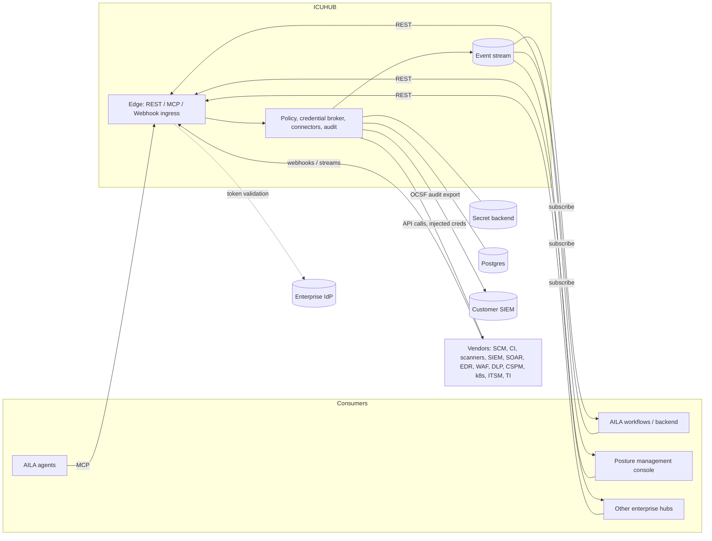
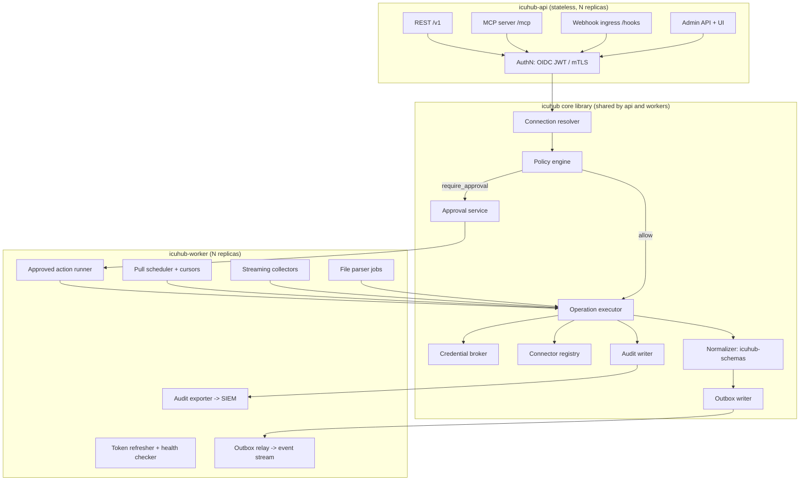
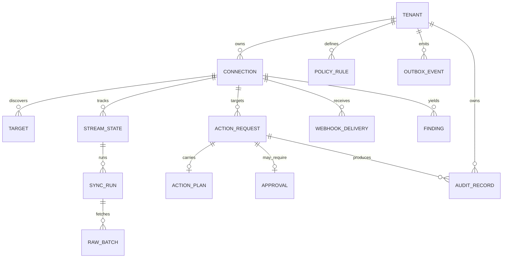
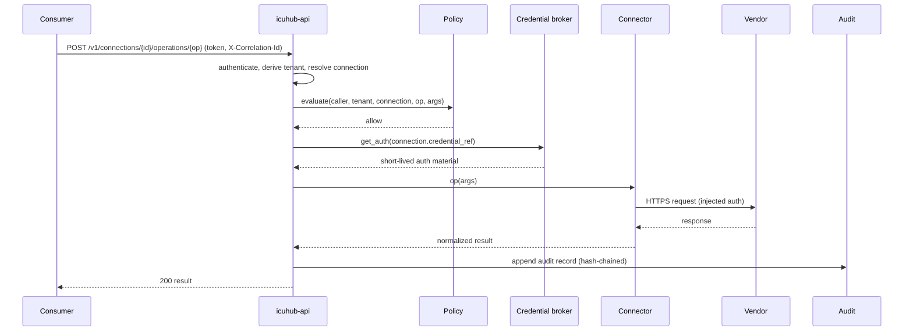
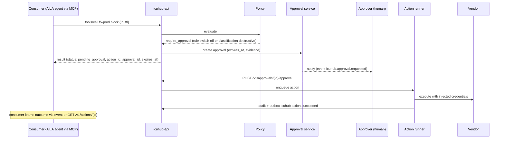
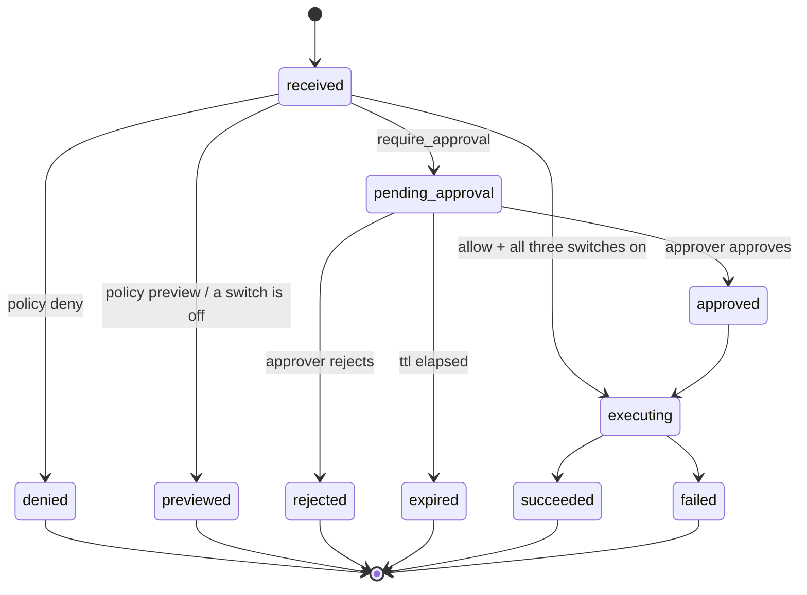
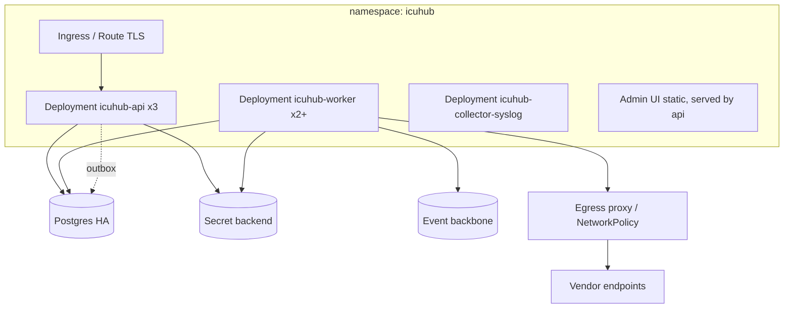

# ICUHUB -- High-Level Design (HLD)

| Field | Value |
|---|---|
| Document | ICUHUB High-Level Design |
| Status | Draft v0.1 |
| Date | 2026-11-05 |
| Requirements | `BRD.md` (IDs `BR-*`, `FR-*`, `NFR-*`, decisions `D*`) |
| Network flows | `COMMATRIX.md` (flow IDs `F-*`) |

Values marked **[decision Dx]** depend on an open decision in `BRD.md` section 18.
Ports and paths are proposed defaults and configurable.

---

## 1. System context



Design rules:

1. ICUHUB contains no AI reasoning and no product logic (BRD NG1, NG2).
2. Consumers never hold vendor credentials (BR-02).
3. Every external call goes through one pipeline: authenticate -> resolve connection
   -> policy -> (approval) -> credential injection -> connector -> normalize -> audit
   -> respond/publish (BR-03).
4. Telemetry never goes through the REST API; it goes collector -> stream (NFR-08).
5. ICUHUB does not import or depend on any consumer codebase.

## 2. Component view



| Component | Responsibility | Requirements |
|---|---|---|
| AuthN | Validate OIDC JWT (service tokens, admin users) or mTLS client cert; derive `caller_id`, `tenant_id`, roles | NFR-01, NFR-04, FR-API-05 |
| REST API | OpenAPI 3.1 surface under `/v1` | FR-API-01 |
| MCP server | Streamable HTTP MCP at `/mcp`; tools per connection, filtered by policy | FR-API-02, BR-06 |
| Webhook ingress | `/hooks/{connection_id}`; verify, dedupe, persist delivery, enqueue normalization | FR-API-04 |
| Admin API + UI | Connections, credentials (write-only), policy, approvals, audit, health, fixture proof status | FR-ADM-01/02 |
| Connection resolver | Load connection by id/slug within the caller's tenant; reject cross-tenant access | NFR-04 |
| Policy engine | Evaluate rules, three switches, classification, egress class, replay mode; return decision | FR-POL-01..08 |
| Approval service | Create durable approval requests, resolve approvers, expire | FR-POL-04..06 |
| Credential broker | Fetch secret by reference, refresh tokens, cache short-lived material in memory only | FR-CON-02..05 |
| Connector registry | Plain dict `kind -> connector class`; operation metadata | FR-CNR-01 |
| Operation executor | Run the operation with timeout, retries per operation idempotency, metrics | FR-CNR-05 |
| Normalizer | Map vendor payloads to OCSF / SARIF; keep raw payload reference | FR-NRM-* |
| Audit writer | Hash-chained audit records per tenant | FR-AUD-* |
| Outbox writer + relay | Transactional outbox in Postgres, relayed to the event stream (at-least-once) | FR-API-03, NFR-06 |
| Pull scheduler | Per connection/stream cursor, bounded per-poll budget | FR-ING-01 |
| Streaming collectors | S3+SQS, Pub/Sub, Event Hubs, syslog/CEF | FR-ING-03 |
| File parser jobs | Uploaded reports -> findings | FR-ING-04 |
| Token refresher / health checker | Proactive refresh, scheduled health checks, `degraded` state | FR-CON-04, FR-CON-06 |
| Audit exporter | OCSF audit export to SIEM | FR-AUD-03 |

## 3. Repository layout (proposed)

```
icuhub/
├── docs/                      # BRD.md, HLD.md, COMMATRIX.md
├── packages/
│   ├── icuhub-schemas/        # OCSF models + SARIF codecs; published separately, used by consumers
│   ├── icuhub-sdk/            # generated Python client from OpenAPI
│   └── icuhub-connector-kit/  # capability protocols, HTTP toolkit, fixture/proof harness
├── src/icuhub/
│   ├── api/                   # FastAPI app: rest/, mcp/, hooks/, admin/
│   ├── core/                  # resolver, policy, approvals, credentials, executor, audit, outbox
│   ├── connectors/            # one package per vendor: github/, gitlab/, f5/, jira/, gti/, ...
│   ├── parsers/               # report-file parsers: fortify_fpr/, nessus_xml/, sarif/, ...
│   ├── collectors/            # s3_sqs/, pubsub/, event_hubs/, syslog_cef/
│   ├── workers/               # scheduler, action runner, refresher, relay, exporter
│   └── storage/               # SQL models + migrations
├── fixtures/                  # vendor-shaped payloads per connector, with expected OCSF outputs
├── deploy/helm/icuhub/        # chart (Kubernetes + OpenShift values)
└── tests/
```

Stack: Python 3.11+ (ADR-0004); Postgres with a transactional outbox feeding Apache
Kafka (ADR-0005); envelope-encrypted credentials with an OpenBao KEK (ADR-0006);
connector toolkit on httpx2, tenacity, aiolimiter, Authlib, asyncpg (ADR-0016);
official MCP Python SDK (server side). FastAPI and SQLAlchemy + Alembic are proposed
and are adopted by ADR when P3 starts.

## 4. Data model



| Table | Key columns | Notes |
|---|---|---|
| `tenant` | `id`, `slug`, `automation_enabled` (tenant switch), `created_at` | Tenant switch of the three switches |
| `connection` | `id`, `tenant_id`, `kind` (registry key), `slug`, `display_name`, `base_url`, `credential_ref`, `settings_json`, `egress_class`, `allowed_operations` (null = all), `status` (`active`/`degraded`/`disabled`), `last_health_at`, `last_health_status` | `credential_ref` points into the secret backend; no secret in DB |
| `policy_rule` | `id`, `tenant_id`, `priority`, `match_json` (caller, connection, operation glob, classification, egress class, argument predicates), `decision` (`allow`/`deny`/`require_approval`/`preview`), `auto_execute_enabled` (rule switch), `approver_group`, `approval_ttl_s` | First match by priority wins; default rule: reads allow, writes and destructive `require_approval` |
| `action_request` | `id`, `tenant_id`, `connection_id`, `operation`, `classification`, `args_json` (encrypted at rest), `args_digest`, `caller_id`, `correlation_id`, `idempotency_key`, `mode` (`live`/`replay`), `state`, `decision`, `result_json`, `error_class`, timestamps | Unique `(tenant_id, caller_id, idempotency_key)` |
| `approval` | `id`, `action_request_id`, `approver_group`, `evidence_json`, `expires_at`, `decided_by`, `decided_at`, `decision`, `reason` | Durable pause |
| `audit_record` | `id`, `tenant_id`, `seq`, `prev_hash`, `hash`, `ts`, `caller_id`, `connection_id`, `operation`, `classification`, `decision`, `approval_id`, `args_digest`, `status`, `http_status`, `latency_ms`, `correlation_id`, `trace_id` | Hash chain per tenant: `hash = H(prev_hash || canonical(record))` |
| `target` | `id`, `connection_id`, `source_uid`, `kind`, `display_name`, `included`, `paused`, `last_seen_at`, `missing_since` | Discovered scope inside a connection (FR-ING-10) |
| `stream_state` | `connection_id`, `target_id`, `stream`, `partition`, `checkpoint_json`, `checkpoint_schema`, `version`, `lease_owner`, `lease_expires_at`, `health`, `last_success_at`, `lag_s` | Typed checkpoint advanced in the outbox transaction with a version check (FR-ING-07) |
| `sync_run` | `id`, `stream_state_key`, `mode` (`incremental`/`full`/`event`/`replay`), `completeness`, `outcome` (`succeeded`/`failed`/`held`/`superseded`), counts per stage, timestamps | One run (FR-ING-09, NFR-18) |
| `raw_batch` | `id`, `sync_run_id`, `digest`, `parser_version`, `payload_ref` (encrypted), `expires_at` | Raw evidence and mapping replay (FR-NRM-07, NFR-16) |
| `quarantine_item` | `id`, `raw_batch_id`, `record_locator`, `error_class`, `parser_version`, `mapper_version`, `replayed_at` | Rejected records (FR-ING-11) |
| `action_plan` | `action_request_id`, `target_ref`, `diff_json`, `preconditions_json`, `idempotency_key`, `plan_hash`, `changed` | Approval binds to `plan_hash` (FR-CNR-17) |
| `webhook_delivery` | `id`, `connection_id`, `vendor_delivery_id`, `received_at`, `signature_valid`, `event_type`, `payload_ref`, `processed_at`, `status` | Unique `(connection_id, vendor_delivery_id)` for dedupe |
| `finding` | `id`, `tenant_id`, `connection_id`, `source_uid`, `fingerprint`, `ocsf_class_uid`, `ocsf_json`, `raw_batch_id`, `parser_version`, `mapper_version`, `first_seen`, `last_seen`, `status` (`open`/`resolved_by_source`/...) | Unique `(tenant_id, fingerprint)`; optional cache, consumers own long-term storage |
| `outbox_event` | `id`, `tenant_id`, `topic`, `event_json`, `created_at`, `relayed_at` | Transactional outbox |
| `fixture_proof` | `connector_kind`, `fixture_id`, `mapping_version`, `last_run_at`, `passed`, `prove_gate_passed` | Earned-executable status (FR-CNR-07) |

All tenant-scoped tables have Postgres row-level security keyed on a per-request
`app.tenant_id` setting (NFR-04).

## 5. Connector framework

### 5.1 Capability protocols

Small, separate protocols. A connector implements only what its vendor supports.

```python
from typing import Protocol
from icuhub_schemas.ocsf import VulnerabilityFinding, DetectionFinding, ComplianceFinding
from icuhub_schemas.common import ChangeRef, Change, Review, CheckStatus, Patch, Page

class SourceControl(Protocol):            # GitHub, GitLab, Bitbucket, Azure DevOps, Gitea
    async def get_change(self, ref: ChangeRef) -> Change: ...
    async def get_diff_files(self, ref: ChangeRef) -> list[FilePatch]: ...
    async def get_file(self, repo: str, path: str, rev: str) -> bytes: ...
    async def post_comment(self, ref: ChangeRef, body: str) -> str: ...
    async def post_review(self, ref: ChangeRef, review: Review) -> str: ...   # inline comments
    async def create_branch(self, repo: str, name: str, from_rev: str) -> str: ...
    async def commit_patch(self, repo: str, branch: str, patch: Patch, message: str) -> str: ...
    async def open_change_request(self, repo: str, source: str, target: str,
                                  title: str, body: str, draft: bool) -> ChangeRef: ...
    async def set_check_status(self, ref: ChangeRef, status: CheckStatus) -> None: ...

class CodeScanningSink(Protocol):         # GitHub code scanning, GitLab security reports, Bitbucket Code Insights
    async def upload_sarif(self, repo: str, rev: str, sarif: dict) -> str: ...

# Ingestion capabilities are stream declarations driven by the host sync engine
# (CONNECTOR_FRAMEWORK.md sections 3 and 5); the connector yields raw batches and a
# proposed checkpoint, the host commits.
#   FindingSource    Fortify, Mend, Invicti, Nessus, Prisma, Wiz, SonarQube  -> @stream(ocsf_class=2002 | 2003 | 2007)
#   TelemetrySource  SIEM, EDR                                             -> @stream(ocsf_class=2004)
#   RiskRegister     RSA Archer and other GRC tools                        -> @stream(RiskRecord)
#   VulnIntel        NVD, EPSS, KEV, OSV, advisories (ADR-0012), FR-FEED-*  -> @stream(AdvisoryRecord)

class TelemetrySearch(Protocol):          # SIEM, EDR (synchronous read)
    async def search(self, query: StructuredQuery) -> Page[dict]: ...           # closed schema, bound parameters

class Enforcer(Protocol):                 # F5, Cloudflare, firewalls, EDR containment
    async def block(self, indicator: Indicator, ttl_s: int, reason: str) -> str: ...
    async def unblock(self, block_id: str) -> None: ...

class Containment(Protocol):              # EDR host isolation
    async def isolate_host(self, host_id: str, reason: str) -> str: ...
    async def release_host(self, host_id: str) -> None: ...

class Tracker(Protocol):                  # Jira, ServiceNow, Service Manager, Maximo (SOAP)
    async def open_ticket(self, ticket: TicketDraft) -> TicketRef: ...
    async def update_ticket(self, ref: TicketRef, patch: TicketPatch) -> None: ...
    async def get_ticket(self, ref: TicketRef) -> Ticket: ...
    async def search_tickets(self, query: TicketQuery, cursor: str | None) -> Page[Ticket]: ...
    async def add_comment(self, ref: TicketRef, body: str) -> str: ...
    async def transition(self, ref: TicketRef, to_state: str, comment: str | None) -> None: ...
    async def list_fields(self, project: str, issue_type: str | None) -> list[TrackerField]: ...
    # Routing, fingerprint dedupe, and status sync (FR-TKT-02..07) run in the core
    # service on top of these primitives; connectors stay vendor-only.

class BuildSystem(Protocol):              # Jenkins, GitLab CI, GitHub Actions, Azure Pipelines
    async def trigger(self, job: str, params: dict[str, str]) -> BuildRef: ...
    async def get_build(self, ref: BuildRef) -> Build: ...
    async def get_artifact(self, ref: BuildRef, name: str) -> bytes: ...

class ClusterOps(Protocol):               # Kubernetes, OpenShift
    async def list_resources(self, kind: str, namespace: str | None) -> list[dict]: ...
    async def get_logs(self, namespace: str, pod: str, container: str | None) -> str: ...

class ThreatIntel(Protocol):              # GTI, MISP, OpenCTI
    async def lookup(self, indicator: Indicator) -> IntelReport: ...

# Added in BRD v0.2 from INTEGRATION_INVENTORY.md

class Notifier(Protocol):                 # SMTP, Teams/Slack/Google Chat webhooks, FR-NTF-*
    async def send(self, message: Notification) -> str: ...

class Directory(Protocol):                # LDAPS, Microsoft Graph, FR-DIR-*
    async def get_user(self, ref: PrincipalRef) -> Principal: ...
    async def list_group_members(self, group: str) -> list[Principal]: ...
    async def get_manager(self, ref: PrincipalRef) -> Principal | None: ...

class SbomSink(Protocol):                 # OWASP Dependency-Track
    async def upload_bom(self, project: ProjectRef, bom: dict) -> str: ...      # CycloneDX 1.7

class KnowledgeBase(Protocol):            # Confluence Cloud, Confluence Data Center, FR-KB-*
    async def get_page(self, ref: PageRef, body_format: str) -> KbPage: ...
    async def search_pages(self, query: PageQuery, cursor: str | None) -> Page[PageSummary]: ...
    async def publish_page(self, draft: PageDraft) -> PageRef: ...              # @action, keyed by natural key, version precondition

```

`web.fetch` (FR-FET-*) is a core operation, not a connector capability: it has no
vendor credential, only destination policy. Remote host execution (SSH/SFTP) is not a
capability: it stays in consumers (ADR-0011, BRD NG13).

Every method is declared as an `@operation` (read) or an `@action` with plan and apply
(write, destructive), with metadata (5.2). Vendor-specific
operations (for example `create_irule` on F5, `list_issue_templates` on Fortify) are
declared on the connector in addition to the capability methods (FR-CNR-03).

### 5.2 Operation metadata

```python
@operation(
    name="get_block",
    capability="Enforcer",
    classification="read",               # read operations use @operation
    egress_class="vendor_tenant",        # internal | vendor_tenant | third_party_shared
    input_schema=BlockRef,               # pydantic model -> JSON Schema for REST and MCP
    output_schema=BlockResult,
)
async def get_block(self, ctx: OpContext, ref: BlockRef) -> BlockResult: ...

@action(
    name="block",
    capability="Enforcer",
    classification="destructive",        # write | destructive use @action: plan, then apply
    egress_class="vendor_tenant",
    idempotency="natural_key",           # none | key | natural_key; drives outcome_unknown reconciliation
    input_schema=BlockInput,
)
class Block: ...                         # plan() and apply(), CONNECTOR_FRAMEWORK.md section 7
```

Each member also carries `stability` (`experimental` / `beta` / `stable`); the manifest
generated from these declarations is described in `CONNECTOR_FRAMEWORK.md` section 4.

### 5.3 Registry

Plain dictionary, no reflection, no discovery magic (PR-Agent pattern). Only
first-party connectors in this repository are registered; no connector package is
loaded from outside it (ADR-0018). Each connector's manifest is generated from its code
and committed (ADR-0017):

```python
CONNECTORS: dict[str, type[Connector]] = {
    "github": GitHub,
    "gitlab": GitLab,
    "bitbucket_cloud": BitbucketCloud,
    "bitbucket_dc": BitbucketDataCenter,
    "azure_devops": AzureDevOps,
    "gitea": Gitea,
    "jira": Jira,
    "servicenow": ServiceNow,
    "f5_bigip": F5BigIp,
    "gti": GoogleThreatIntel,
    "fortify_ssc": FortifySsc,
    "jenkins": Jenkins,
    # MCP-backed connectors register the same way
    "kubernetes_mcp": KubernetesMcp,
}
```

### 5.4 Connector types

| Type | What it is | Example |
|---|---|---|
| Native | Python class calling the vendor API through the HTTP toolkit | GitHub, F5 iControl REST, Jira |
| MCP-backed | ICUHUB acts as MCP client to a vendor-official MCP server; its tools are re-exposed through ICUHUB's policy, credential injection, and audit | GitLab `/api/v4/mcp`, Jenkins MCP plugin, `containers/kubernetes-mcp-server`, `google/mcp-security`, Wiz MCP |
| File parser | Uploaded report file -> normalized findings | Fortify FPR, Nessus `.nessus`, Burp XML, SARIF, CycloneDX |

MCP-backed connectors still need an operation manifest: each upstream tool gets a
classification and egress class in ICUHUB (unclassified upstream tools are hidden).

### 5.5 HTTP toolkit (connector kit)

| Concern | Behaviour |
|---|---|
| Timeouts | Connect 5 s, read 30 s default; per operation override |
| Retries | Exponential backoff with jitter on connect errors, 502/503/504; only for reads and for actions whose `idempotency` is not `none`; an unretried send that times out ends `outcome_unknown` |
| Rate limits | Honour `429` + `Retry-After`, vendor-specific headers (`X-RateLimit-*`), per-connection token bucket |
| Pagination | Helpers for link-header, cursor, offset/limit, page-token styles |
| Auth | Pluggable auth strategies fed by the credential broker (2.FR-CON-02) |
| TLS | Custom CA bundles per connection (enterprise PKI), optional client cert |
| Proxy | Per-connection or global egress proxy |
| Signing | HMAC request signing where vendors require it |
| Logging | Request line, status, latency; never headers with credentials, never bodies by default |

### 5.6 Fixture proof gate (earned-executable)

For every mapping:

1. `fixtures/<kind>/<case>.json` holds a vendor-shaped payload captured from docs or a
   sanitized real response.
2. `fixtures/<kind>/<case>.expected.ocsf.json` holds the expected normalized output.
3. CI replays the fixture through the real connector + normalizer and diffs the output.
4. Prove gate: CI runs again with the connector mapping reverted (mapping disabled) and
   asserts the expected output is no longer produced.
5. `fixture_proof` rows record pass/fail; the admin surface shows a mapping as live only
   when both checks pass.

## 6. Request pipeline

### 6.1 Synchronous operation (read)



### 6.2 Write / destructive operation with approval



### 6.3 Action request state machine



Rules:
- Reads skip approval states but still pass policy and audit.
- `mode=replay` requests can only reach `denied` or `previewed` for write/destructive
  operations (FR-POL-08).
- Every transition writes an audit record and an outbox event.
- Write and destructive actions go through plan and apply, which adds the states
  `stale_plan`, `no_op`, `accepted_async`, and `outcome_unknown`
  (`CONNECTOR_FRAMEWORK.md` section 7.2, FR-POL-09).

### 6.4 Three switches

| Switch | Where | Default |
|---|---|---|
| Deployment | Helm value / env `ICUHUB_AUTOMATION_ENABLED` | off |
| Tenant | `tenant.automation_enabled` | off |
| Rule | `policy_rule.auto_execute_enabled` | off |

A write/destructive action executes without human approval only if all three are on
and the matching rule decision is `allow`. Otherwise the action is previewed or
requires approval.

## 7. Entry points

### 7.1 REST API (`/v1`)

Common headers:

| Header | Required | Purpose |
|---|---|---|
| `Authorization: Bearer <jwt>` (or mTLS) | yes | Caller identity; tenant claim `icuhub_tenant` |
| `X-Correlation-Id` | yes for operations | Consumer correlation (for example AILA investigation ID) |
| `Idempotency-Key` | yes for write/destructive | Dedup of retries |
| `X-ICUHUB-Mode: replay` | no | Replay/simulation mode |
| `traceparent` | no | W3C trace context |

Endpoints:

| Method | Path | Purpose | Roles / callers |
|---|---|---|---|
| GET | `/v1/connectors` | Registered connector kinds, capabilities, operations | any authenticated |
| GET | `/v1/connections` | Tenant connections (no secrets) | service, admin, viewer |
| POST | `/v1/connections` | Create connection | admin |
| PATCH | `/v1/connections/{id}` | Update connection | admin |
| PUT | `/v1/connections/{id}/credential` | Write credential (write-only) | admin |
| POST | `/v1/connections/{id}/health` | Run health check | admin, service |
| GET | `/v1/connections/{id}/operations` | Operations available to this caller | service |
| POST | `/v1/connections/{id}/operations/{operation}` | Invoke operation | service |
| GET | `/v1/actions/{id}` | Action request state and result | service, admin, auditor |
| GET | `/v1/findings` | Cached normalized findings (filter by connection, class, since) | service |
| POST | `/v1/connections/{id}/reports` | Upload report file for parsing | service, admin |
| GET | `/v1/approvals` | Pending approvals for caller's groups | approver |
| POST | `/v1/approvals/{id}/approve` | Approve | approver |
| POST | `/v1/approvals/{id}/reject` | Reject with reason | approver |
| GET | `/v1/policy/rules` / POST / PATCH / DELETE | Policy management | admin |
| GET | `/v1/audit` | Audit search | auditor, admin |
| GET | `/v1/audit/verify` | Verify hash chain for a range | auditor |
| GET | `/healthz`, `/readyz` | Liveness / readiness | platform |
| GET | `/metrics` | Prometheus metrics | platform |

Error model (RFC 9457 problem details):

```json
{
  "type": "https://icuhub/errors/policy-denied",
  "title": "Policy denied",
  "status": 403,
  "detail": "Operation f5_bigip.block is destructive and denied for caller aila-backend",
  "action_id": "act_01JC...",
  "correlation_id": "inv_7f3c..."
}
```

### 7.2 MCP endpoint (`/mcp`)

- Transport: MCP Streamable HTTP.
- Auth: same bearer token / mTLS as REST; tenant from the token.
- Tool naming: `<connection_slug>.<operation>` (for example `gitlab-main.open_change_request`,
  `f5-prod.block`, `gti.lookup`).
- `tools/list` returns only tools the caller is allowed to call or request (policy
  decision not `deny`); each tool carries JSON Schema from the operation metadata and
  annotations: `readOnlyHint` for reads, `destructiveHint` for destructive.
- `tools/call` runs the same pipeline as REST. A call needing approval returns a
  normal result with `status: pending_approval` (not an MCP error), so agents can reason
  about it.
- `X-Correlation-Id` is passed as an HTTP header on the MCP session; per-call override
  via `_meta.correlation_id`.

### 7.3 Event stream

Envelope: CloudEvents 1.0 (structured JSON) with OCSF payload where applicable
(ADR-0009). Backbone: Postgres outbox relayed to Apache Kafka (ADR-0005).

| Topic | Emitted when | Payload |
|---|---|---|
| `icuhub.finding.upserted` | New or changed finding from pull, webhook, or parser | OCSF Findings class (2002 / 2003 / 2004 / 2005 / 2006) |
| `icuhub.telemetry.event` | Telemetry from collectors / SIEM / EDR pulls | OCSF event class |
| `icuhub.scm.change_request.opened` / `.updated` / `.merged` / `.closed` | SCM webhooks | ICUHUB SCM model (with OCSF-compatible actor/resource projection) |
| `icuhub.scm.push` | Push to a tracked branch | SCM model |
| `icuhub.ci.build.completed` | CI webhook or poll | CI model |
| `icuhub.ticket.updated` | Tracker webhook | Tracker model |
| `icuhub.action.*` (`requested`, `previewed`, `pending_approval`, `approved`, `rejected`, `expired`, `succeeded`, `failed`) | Action state transitions | Action summary (no secrets, args digest) |
| `icuhub.approval.requested` | Approval created | Approval summary |
| `icuhub.connection.degraded` / `.recovered` | Health or refresh change | Connection summary |

Delivery: at-least-once from the transactional outbox; consumers dedupe by CloudEvents
`id`. Partition / subject key: `tenant_id + connection_id` to keep per-connection order.

### 7.4 Webhook ingress (`/hooks/{connection_id}`)

| Vendor | Verification |
|---|---|
| GitHub | `X-Hub-Signature-256` HMAC-SHA256 over body; `X-GitHub-Delivery` for dedupe |
| GitLab | `X-Gitlab-Token` shared secret (constant-time compare); `X-Gitlab-Event-UUID` / idempotency key for dedupe |
| Bitbucket Cloud | `X-Hub-Signature` HMAC; `X-Request-UUID` for dedupe |
| Azure DevOps | Basic auth or custom header secret on the service hook |
| Jira / ServiceNow | Shared secret header or JWT per vendor configuration |
| Jenkins | Shared secret header (plugin-configured) |

Pipeline: verify signature -> reject if timestamp outside window (where vendor provides
one) -> insert `webhook_delivery` (unique constraint dedupes) -> 202 fast -> worker
normalizes -> outbox event. Unknown or failed-signature deliveries are recorded with
`signature_valid=false` and dropped. Exact header names must be confirmed per vendor
version during connector implementation.

## 8. Normalization (`icuhub-schemas`)

- Published as its own package, versioned independently; consumers (AILA, posture
  console) import it to read and write the same models (BR-05).
- OCSF pinned to 1.9.0; ICUHUB-owned Pydantic models validated against the vendored
  official per-class JSON schemas (ADR-0008).
- SARIF 2.1.0 import and export; `findings_to_sarif` converts code-located findings and
  returns the findings it skipped (FR-NRM-06).
- CloudEvents 1.0 envelope model with `tenantid` and `correlationid` extensions (ADR-0009).
- Activity projection on every event: `actor`, `action`, `resource`, `location`,
  `outcome`; `actor.kind` taken from the vendor's documented field (FR-NRM-03). Built by
  connector mappers in P2 on top of these models.
- Fields without a vendor source stay null and are omitted; vendor fields OCSF cannot
  represent go to `unmapped` (FR-NRM-05).
- `raw_data` (an OCSF string attribute) keeps the original vendor payload up to a bound;
  larger payloads are stored by reference in object storage (P3) (FR-NRM-04).
- Required by the 1.9.0 schema on finding classes and easy to miss: `metadata.product`,
  `metadata.version`, `finding_info.uid`, `cloud` (with `provider`), and `osint` (array,
  may be empty). Incident Finding (2005) uses `finding_info_list` instead of
  `finding_info`; Compliance Finding (2003) requires `compliance`.
- `type_uid` is always `class_uid * 100 + activity_id`; a different supplied value is
  rejected.
- Fingerprint: `fp_` + `sha256(connector_kind | rule_or_check_id | normalized_location | normalized_component)`;
  kind lowercased, paths use `/` without a leading `./`, `None` becomes empty, a `|`
  inside a field is rejected.

Example: Fortify issue -> OCSF Vulnerability Finding. This document passes
`validate_ocsf` and round-trips through `VulnerabilityFinding`:

```json
{
  "class_uid": 2002,
  "category_uid": 2,
  "activity_id": 1,
  "type_uid": 200201,
  "severity_id": 4,
  "time": 1762300800000,
  "metadata": {
    "version": "1.9.0",
    "product": {"name": "Fortify SSC", "vendor_name": "OpenText"},
    "uid": "fortify-ssc:issue:88213"
  },
  "cloud": {"provider": "on-premises"},
  "osint": [],
  "finding_info": {
    "uid": "fp_9c1e",
    "title": "SQL Injection",
    "types": ["SAST"],
    "first_seen_time": 1762200000000
  },
  "vulnerabilities": [{
    "cwe": {"uid": "89"},
    "affected_code": [{
      "file": {"name": "repo.py", "path": "src/orders/repo.py", "type_id": 1},
      "start_line": 41,
      "end_line": 44
    }]
  }],
  "resources": [{"type": "repository", "name": "acme/orders"}],
  "raw_data": "{\"issueInstanceId\": \"88213\"}",
  "unmapped": {"fortify_kingdom": "Input Validation and Representation"}
}
```

## 9. Ingestion

| Mode | Mechanism | State | Backpressure |
|---|---|---|---|
| Scheduled pull | Sync engine per stream state (`CONNECTOR_FRAMEWORK.md` section 5) | `stream_state` row | Per-poll budget (max records / max seconds); lag reported |
| Webhook push | `/hooks` | `webhook_delivery` | Fast 202, async normalize |
| Streaming collectors | S3+SQS, Pub/Sub, Event Hubs consumers, syslog/CEF TCP/TLS listener | Consumer offsets / ack | Bounded in-flight, ack after outbox commit |
| File parsers | Upload via REST | Parser job record | Size limits, async job |

## 10. Security architecture

| Area | Design |
|---|---|
| Caller authentication | OIDC client-credentials JWT from enterprise IdP (audience `icuhub`), or mTLS with SPIFFE/mesh identity; admin users via OIDC/SAML SSO |
| Tenant derivation | From token claim only; `X-Tenant` header accepted only for admin tokens with multi-tenant scope, and must match an allowed tenant |
| Authorization | Role claims for admin surface; policy engine for operations |
| Credentials | Secret backend **[D3]**; broker caches decrypted material in memory with TTL; never logged; never returned |
| Egress | Default-deny NetworkPolicy; egress only to connection endpoints (optionally via egress proxy with allowlist generated from connections) |
| Data classes | `egress_class` on connection and operation; `third_party_shared` (for example public threat-intel lookups that join a shared dataset) requires explicit policy |
| Audit integrity | Per-tenant hash chain, periodic anchor export to SIEM |
| Supply chain | Signed images, SBOM per release, pinned dependencies |
| Runtime | Non-root, arbitrary UID, read-only root FS, no privilege escalation, seccomp default (OpenShift restricted SCC compatible) |
| Input safety | All operation inputs validated by schema; structured queries (closed schema, bound parameters) for SIEM search, no free-form query strings from agents |
| Webhooks | Signature verification, replay window, dedupe, size limits |

## 11. Deployment



| Item | Value |
|---|---|
| Packaging | Helm chart `deploy/helm/icuhub`; OpenShift values (Route instead of Ingress, restricted SCC) |
| Replicas | api >= 2 (HA), worker >= 2, collectors per source |
| Config | Helm values + ConfigMap; secrets via External Secrets / Vault agent **[D3]** |
| Migrations | Alembic job (pre-upgrade hook) |
| Air-gap | All images mirrorable; no runtime internet except configured vendor endpoints |
| Topology | One ICUHUB per enterprise install, shared by all consumers **[D4]** |

## 12. Observability

| Signal | Detail |
|---|---|
| Traces | OpenTelemetry; spans per pipeline step; `correlation_id`, `tenant_id`, `connection_id`, `operation` attributes |
| Metrics | Calls per operation/status, vendor latency, policy decisions, approvals pending/expired, cursor lag, webhook dedupe hits, outbox lag, token refresh failures |
| Logs | Structured JSON; no secrets; no bodies by default |
| Health | `/healthz`, `/readyz`; per-connection health exposed via API and events; unknown health reported as `unknown`, never `ok` |

## 13. Failure handling

| Failure | Behaviour |
|---|---|
| Vendor 5xx / timeout | Retry only idempotent operations or reads; then `failed` with `error_class` |
| Vendor 429 | Respect `Retry-After`; per-connection token bucket |
| Token refresh failure | Connection `degraded`; event `icuhub.connection.degraded`; calls return 503 with problem details |
| Event backbone down | Outbox accumulates in Postgres; relay resumes; no event loss |
| Worker crash mid-action | Action stays `executing` with lease; lease expiry re-queues only if operation is idempotent, otherwise marks `failed` with `interrupted` and requires human review |
| Approval never decided | Expires at TTL with `expired` outcome and event |
| Duplicate webhook | Unique constraint dedupes; 200 returned |
| Duplicate operation call | `Idempotency-Key` returns original result |

## 14. Versioning and compatibility

| Surface | Policy |
|---|---|
| REST | `/v1`; additive changes only; breaking change -> `/v2` alongside |
| MCP tools | Tool names stable per operation; schema changes additive; removed operations disappear from `tools/list` |
| Events | CloudEvents `type` carries version suffix when payload breaks (`icuhub.finding.upserted.v2`) |
| `icuhub-schemas` | Semver; pinned OCSF version recorded in package metadata |
| SDK | Generated per API release |

## 15. Consumer integration contract

### 15.1 Any consumer

1. Register a service client in the IdP (client credentials, audience `icuhub`) or get
   a mesh identity.
2. Admin grants the client a tenant and policy rules.
3. Call REST / MCP with token + `X-Correlation-Id`; subscribe to topics needed.
4. Import `icuhub-schemas` to read OCSF/SARIF payloads.
5. Never call vendor APIs directly.

### 15.2 AILA (first consumer)

| AILA side | Change |
|---|---|
| MCP | Register ICUHUB as one MCP server (`icuhub`) in `aila/platform/mcp/server_specs.py` and the DB instance catalog; URL `https://icuhub.<ns>/mcp`; token from ConfigRegistry-resolved client credentials |
| Tool governance | AILA `tool_authority` allowlists `icuhub` per module; AILA's own approval UI surfaces `pending_approval` results; ICUHUB remains the enforcement point |
| Correlation | AILA sets `X-Correlation-Id` = investigation id (and branch/turn in `_meta`) so ICUHUB audit joins AILA's tool-call ledger |
| Events | New AILA event subscriber (platform-owned) consumes `icuhub.scm.change_request.opened`, `icuhub.finding.upserted`, `icuhub.action.*` and starts or advances `DurableStateMachine` workflows |
| VR exploit-and-fix delivery | After regression gates pass, AILA calls `gitlab-main.open_change_request` / `github-main.open_change_request` (draft by default) and `upload_sarif` |
| Boundary enforcement | AILA `make check` gains an audit that fails on direct vendor HTTP clients or vendor SDK imports outside allowlisted transport files |
| Schemas | AILA canonical finding export uses `icuhub-schemas` OCSF/SARIF codecs |

### 15.3 Posture management console

Pulls `GET /v1/findings` and subscribes to `icuhub.finding.upserted` for CSPM/CNAPP
(Prisma Cloud, Wiz, SCC), scanner, and SAST/SCA findings; uses `Tracker.open_ticket`
through ICUHUB for remediation tickets.

## 16. Worked examples

### 16.1 Posture console pulls Prisma Cloud findings

```http
GET /v1/findings?connection=prisma-prod&class_uid=2003&since=2026-11-01T00:00:00Z
Authorization: Bearer eyJ... (client posture-console, tenant acme)
X-Correlation-Id: posture-sync-2026-11-05
```
```json
{"items": [{"class_uid": 2003, "finding_info": {"uid": "fp_..", "title": "S3 bucket public read"}, "...": "..."}],
 "next_cursor": "c_01JC..."}
```

### 16.2 AILA agent blocks an IP on F5 (approval)

MCP request:
```json
{"jsonrpc": "2.0", "id": 17, "method": "tools/call",
 "params": {"name": "f5-prod.block",
            "arguments": {"indicator": {"type": "ipv4", "value": "203.0.113.45"}, "ttl_s": 86400,
                          "reason": "Confirmed exploitation attempt, see investigation"},
            "_meta": {"correlation_id": "inv_7f3c", "branch": "b2", "turn": 14}}}
```
MCP result:
```json
{"jsonrpc": "2.0", "id": 17,
 "result": {"content": [{"type": "text", "text": "{\"status\":\"pending_approval\",\"action_id\":\"act_01JC9\",\"approval_id\":\"apr_01JC9\",\"expires_at\":\"2026-11-05T18:00:00Z\"}"}],
            "structuredContent": {"status": "pending_approval", "action_id": "act_01JC9",
                                  "approval_id": "apr_01JC9", "expires_at": "2026-11-05T18:00:00Z"}}}
```
Approver approves -> event `icuhub.action.succeeded` with `correlation_id: inv_7f3c`.

### 16.3 GitLab MR opened -> AILA investigation -> fix MR

1. GitLab -> `POST /hooks/con_gitlab_main` (`X-Gitlab-Token`, `X-Gitlab-Event: Merge Request Hook`).
2. ICUHUB verifies, stores delivery, returns 202, publishes:
```json
{"specversion": "1.0", "id": "evt_01JCA", "source": "icuhub/connections/con_gitlab_main",
 "type": "icuhub.scm.change_request.opened", "subject": "acme/orders!412",
 "time": "2026-11-05T10:12:00Z", "datacontenttype": "application/json",
 "icuhubtenant": "acme",
 "data": {"repo": "acme/orders", "number": 412, "source_branch": "feat/export",
          "target_branch": "main", "head_sha": "9f1c2ab", "author": {"kind": "user", "name": "dev1"}}}
```
3. AILA subscriber starts a VR investigation (correlation `inv_8a10`).
4. After PoV proven and fix passes regression gates, AILA calls:
```http
POST /v1/connections/con_gitlab_main/operations/open_change_request
Authorization: Bearer eyJ... (client aila-backend)
X-Correlation-Id: inv_8a10
Idempotency-Key: inv_8a10-fix-1
Content-Type: application/json

{"repo": "acme/orders", "source": "aila/fix-inv_8a10", "target": "feat/export",
 "title": "Fix SQL injection in orders export", "body": "Evidence: ...", "draft": true}
```
Policy: `open_change_request` is `write` -> default `require_approval` unless tenant
rule allows draft MRs automatically.

### 16.4 Connector definition (abbreviated)

```python
class F5BigIp(Connector):
    kind = "f5_bigip"
    version = "0.1.0"
    sdk = ">=1,<2"
    owner = "@icuhub/network-connectors"
    support = "core"
    config = F5Config
    auth = (TokenAuth(login_path="/mgmt/shared/authn/login"),)   # iControl REST token auth

    @action(name="block", capability="Enforcer", classification="destructive",
            egress_class="vendor_tenant", idempotency="natural_key", partition_key="data_group",
            input_schema=BlockInput, stability="beta")
    class Block:
        async def plan(self, ctx: PlanContext, args: BlockInput) -> ActionPlan:
            ...  # read the managed data-group; diff adds the address; precondition: data-group generation
        async def apply(self, ctx: ApplyContext, plan: ActionPlan) -> ActionOutcome:
            ...  # PATCH the data-group bound to the AFM/ASM policy; outcome carries the new generation

    @operation(name="list_virtual_servers", classification="read", egress_class="vendor_tenant",
               idempotent=True, input_schema=Empty, output_schema=VirtualServerList)
    async def list_virtual_servers(self) -> list[VirtualServer]:
        ...
```

### 16.5 Connection configuration

```json
{
  "kind": "f5_bigip",
  "slug": "f5-prod",
  "display_name": "F5 BIG-IP production DMZ",
  "base_url": "https://bigip-dmz.acme.internal",
  "credential_ref": "vault:kv/icuhub/acme/f5-prod",
  "settings": {"partition": "Common", "address_list": "icuhub_blocklist", "ca_bundle_ref": "vault:kv/pki/acme-root"},
  "egress_class": "vendor_tenant",
  "allowed_operations": ["list_virtual_servers", "block", "unblock"]
}
```

### 16.6 Policy rule

```json
{
  "priority": 100,
  "match": {"caller": "aila-backend", "connection": "f5-prod", "operation": "block",
            "args": {"ttl_s": {"lte": 86400}}},
  "decision": "require_approval",
  "auto_execute_enabled": false,
  "approver_group": "soc-leads",
  "approval_ttl_s": 3600
}
```

## 17. Testing strategy

| Level | What |
|---|---|
| Unit | Policy evaluation, state machine transitions, hash chain, normalizers |
| Fixture proof | Per connector mapping: replay + prove gate (5.6) in CI |
| Contract | OpenAPI schema diff check; event schema check; SDK generation in CI |
| Integration | Postgres + event backbone in CI; webhook signature tests per vendor |
| Connector conformance | Generic suite every connector inherits, manifest regeneration check, HTTP contract cassettes (`CONNECTOR_FRAMEWORK.md` section 10) |
| Sandbox vendors | Live acceptance with `ICUHUB_ACC=1` against vendor sandboxes; required for `core` connectors before release (FR-CNR-16) |
| Consumer contract | AILA CI runs its ICUHUB adapter tests against a pinned ICUHUB image |

## 18. Roadmap

The delivery plan lives in `ROADMAP.md` (phases P0 to P10, each run as brainstorm,
write, plan, implement, test). Summary:

| Phase | Deliverable | Exit criteria |
|---|---|---|
| P0 | Decisions D1-D14 closed as ADRs; skeleton and CI | Recorded in BRD section 18 |
| P1 | `icuhub-schemas` (OCSF pin, SARIF codec, CloudEvents envelope, fingerprint) | Round-trip and validation tests; consumers can import |
| P2 | Connector kit (protocols, operations, registry, HTTP and SOAP toolkit, proof harness) | Reference connector live through the proof gate |
| P3 | Core service (tenancy/RLS, connections, credentials, policy, approvals, audit, outbox, REST) | Example 16.2 end to end with the reference connector; audit chain verifies |
| P4 | MCP endpoint, webhook ingress, event relay, SMTP notifier | Example 16.3 with recorded payloads |
| P5 | Wave-1 connectors and ticket routing | Fixture proofs; examples 16.1-16.3 on sandboxes |
| P6 | AILA consumer side (15.2) | Boundary audit green for wave-1 vendors |
| P7 | Scan-platform migration (ticket routes, result-file ingestion) | Scan platform files tickets only through ICUHUB; no duplicates on re-run |
| P8 | AppSec middleware parity connectors | Parity fixture per inventory row |
| P9 | Governed fetch, MCP governance, vuln-intel mirror, directory | AILA fetch and MCP catalog through ICUHUB |
| P10 | Collectors, wave 3, Helm/OpenShift hardening, HA, SIEM export | Restricted SCC install; failover and restore rehearsed |
