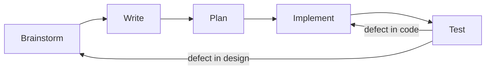
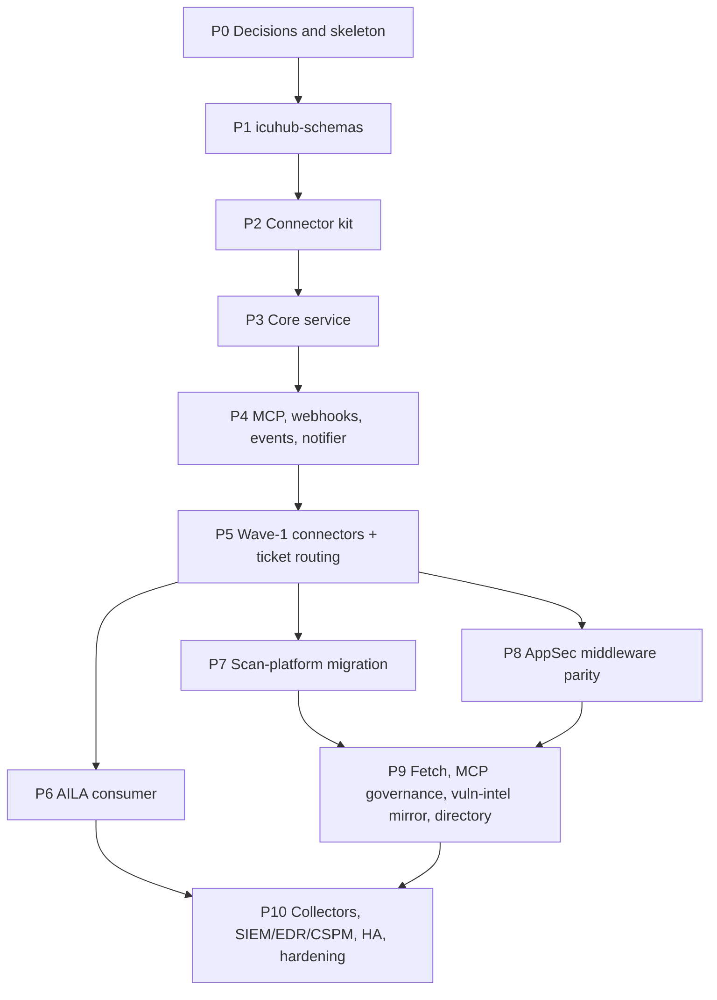

# ICUHUB -- Delivery Roadmap

| Field | Value |
|---|---|
| Document | Phase-by-phase delivery plan |
| Status | v0.1 |
| Date | 2026-11-06 |
| Inputs | `BRD.md` v0.2, `HLD.md`, `INTEGRATION_INVENTORY.md`, `OPTIONS.md` |
| Replaces | `HLD.md` section 18 (now a pointer to this document) |

---

## 1. How every step runs

Every unit of work (a phase, or a task inside a phase) follows the same five steps.
A step is finished only when its artifact exists; the next step starts from that
artifact, not from memory.

| Step | What happens | Artifact | Gate |
|---|---|---|---|
| Brainstorm | List options, unknowns, vendor facts to check, risks; name the requirement IDs in play | Notes in the PR description or an ADR draft | Every open decision touched is either closed (ADR) or explicitly deferred |
| Write | Update the canonical docs before code: BRD rows (append only), HLD section, connector operation table (`CONNECTOR_GUIDE.md` section 2), ADRs | Doc diff | Docs describe the behaviour the code will have; no feature described as implemented |
| Plan | Break the work into tasks that each map to IDs (FR-*, F-*, INV-*), with the files they touch and the behaviour each test will prove | Task list in the PR description | Each task has an acceptance statement |
| Implement | Code to the plan; only dependencies approved in an ADR | Code diff | `ruff`, `compileall` clean |
| Test | Tests for the new behaviour only: decisions, transitions, boundaries, errors, normalization output, signature checks (AGENTS.md 5.6). The full suite is not part of the step | New tests passing; fixture proofs for new mappings | Targeted `pytest` run on the new test files passes |

Rules that apply to every phase:

1. No dependency enters `pyproject.toml` without an ADR approved by the operator.
2. Requirement IDs are cited in commits and PR titles.
3. Each phase ends with a patch release (`0.0.x`), a CHANGELOG entry, and a PR from
   `dev` to `main`.

## 2. Phase map

| Phase | Theme | Decisions applied | Main requirement IDs |
|---|---|---|---|
| P0 | Decisions, CI, license check | D1..D14 (closed) | NFR-15 |
| P1 | Shared schema package | ADR-0008, ADR-0009 | FR-NRM-01..06, BR-05, BR-14 |
| P2 | Connector kit | ADR-0016 | FR-CNR-01..11, FR-ING-04..06, BR-13, BR-26 |
| P3 | Core service | ADR-0006, 0007, 0013, 0014 | FR-CON-*, FR-POL-*, FR-AUD-01..05, FR-API-01, 05..07, FR-ADM-*, BR-19, BR-21 |
| P4 | Entry points | ADR-0005, 0009, 0010 | FR-API-02..04, FR-NTF-01..04 |
| P5 | Wave-1 connectors, ticket routing | ADR-0010, 0015 | FR-TKT-01..08, BR-16 |
| P6 | AILA consumer | -- | FR-MIG-01..05 (AILA rows) |
| P7 | Scan-platform migration | ADR-0011, 0015 | FR-ING-06, FR-TKT-*, FR-MIG-* |
| P8 | AppSec middleware parity | -- | FR-CNR-08, FR-DIR-*, FR-ADM-04, FR-MIG-* |
| P9 | Governed fetch, MCP governance, vuln-intel mirror | ADR-0012 | FR-FET-*, FR-MCPG-*, FR-FEED-* |
| P10 | Scale and hardening | -- | FR-ING-01..03, FR-AUD-03, NFR-02, 05, 10, 13, 14 |

## 3. Phases

### P0 -- Decisions, skeleton, CI

| Step | Content |
|---|---|
| Brainstorm | Review `OPTIONS.md` with the operator; confirm scope boundaries NG8..NG13 |
| Write | ADR per decision (D1..D14) in `docs/adr/`; BRD section 18 marks each decision closed with its ADR number |
| Plan | CI jobs (ruff, compileall, targeted pytest, license check per NFR-15). Packages from HLD section 3 and the single settings module are created when their first code lands, never as empty placeholders |
| Implement | CI and `tools/license_check.py`; no runtime features |
| Test | CI runs on the PR; license check rejects a deliberately non-compatible test package in its own unit test |

Tasks:

| ID | Task | Acceptance |
|---|---|---|
| R-0.1 | Close D1..D14 as ADRs | Every row in BRD section 18 references an ADR |
| R-0.2 | CI and license check | CI runs lint, compile, the new tests, and the license check on every PR |
| R-0.3 | Withdrawn (ID reserved) | -- |

Exit: all blocking decisions for P1..P3 closed; CI enforces lint, compile, tests, licenses.

### P1 -- `icuhub-schemas`

| Step | Content |
|---|---|
| Brainstorm | Which OCSF classes and objects wave 1 and the parity phases need (2002, 2003, 2004, 2005, 2006, 2007, 6003); fingerprint rules per finding type; how unmapped fields are recorded |
| Write | HLD section 8 updated with the pinned version, class list, and fingerprint definition |
| Plan | Models, codecs, validators, fingerprint, envelope |
| Implement | Package `packages/icuhub-schemas`: OCSF models for the selected classes (pinned 1.9.0, ADR-0008), `type_uid` computation, `unmapped` and `raw_data` handling, validation against the vendored OCSF JSON schema export, SARIF 2.1.0 read/write codec, CloudEvents 1.0 envelope (ADR-0009), stable finding fingerprint (FR-ING-05) |
| Test | Round trip per class; schema validation rejects missing required attributes; `type_uid` arithmetic; fingerprint stable across field order and volatile fields; SARIF round trip on a sample log; unmapped values preserved, never defaulted (FR-NRM-05) |

Exit: a consumer can `pip install` the package and read/write OCSF and SARIF objects
that validate against the pinned schema.

### P2 -- Connector kit

| Step | Content |
|---|---|
| Brainstorm | Manifest versus code split (`OPTIONS.md` section 1); auth strategy list (FR-CON-02); retry and limiter semantics across replicas |
| Write | HLD sections 5.2 to 5.6 updated; `CONNECTOR_GUIDE.md` operation table filled for the reference connector |
| Plan | Base classes, decorators, registry, toolkit modules, proof harness |
| Implement | `Connector` base, capability protocols (HLD 5.1) and their common types (`Page`, refs, drafts), `@operation` metadata with JSON Schema output, `CONNECTORS` dict, HTTP toolkit (timeouts, retries for idempotent operations, `Retry-After`, local limiter plus a shared bucket interface, pagination styles, auth strategies, CA bundles and client certificates, proxy, HMAC signing), SOAP codec (FR-CNR-08), query builders with escaping (FR-CNR-10), RFC 9457 error types, tabular mapping profiles (FR-ING-06), fixture replay and prove gate harness (HLD 5.6), one reference connector against a local fixture server |
| Test | Retry only on idempotent operations; `Retry-After` honoured; pagination terminates and resumes; LDAP filter escaping vectors; SOAP fault to typed error; TLS verification cannot be disabled; fixture replay produces expected OCSF and the prove gate fails with the mapping reverted |

Exit: the reference connector reaches "live" through the proof gate in CI.

### P3 -- Core service

| Step | Content |
|---|---|
| Brainstorm | Tenancy enforcement with RLS; action state machine edge cases (expiry during execution, retries after crash); SoD rules |
| Write | HLD sections 4, 6, 10 updated to the chosen engines (ADR-0006, ADR-0013, ADR-0014); migrations listed |
| Plan | Data model and migrations, services, REST routers |
| Implement | Postgres schema with RLS and migrations; service authentication (OIDC client credentials; one ICUHUB per install, ADR-0007); connection store; credential broker with envelope encryption and an OpenBao KEK (ADR-0006); typed policy rules (ADR-0013) with the three switches and egress classes; action request state machine and durable approvals with expiry on the Postgres job queue (ADR-0014); SoD constraints (FR-ADM-03); hash-chained audit with digest-preserving purge (FR-AUD-02, FR-AUD-05); transactional outbox; idempotency keys; REST `/v1` with OpenAPI 3.1; generated client SDK |
| Test | Policy decision table; every state transition including expiry and crash recovery; self-approval and SoD denials; cross-tenant reads denied under RLS; audit chain verification detects a modified row; idempotent replay returns the original result |

Exit: HLD example 16.2 runs end to end against the reference connector; audit chain
verifies.

### P4 -- MCP endpoint, webhook ingress, events, notifier

| Step | Content |
|---|---|
| Brainstorm | MCP protocol revision and auth; webhook verifier per vendor; event topics and retention |
| Write | HLD section 7 updated; COMMATRIX flows confirmed for Kafka (ADR-0005) |
| Plan | MCP server, ingress, relay, notifier |
| Implement | `/mcp` (Streamable HTTP) listing tools per caller and tenant, filtered by policy; webhook ingress with random endpoint IDs, inbox table, per-vendor verifiers, replay window, dedupe; outbox relay to Kafka with CloudEvents envelopes; `Notifier` SMTP connector and approval notifications (FR-NTF-01..04) |
| Test | Tool list differs by policy; `pending_approval` result shape; each verifier accepts the vendor sample and rejects a modified body, stale timestamp, and replayed delivery; relay publishes once per outbox row under restart; approval notification rendered from template |

Exit: HLD example 16.3 runs with recorded vendor payloads; approvals notify approvers.

### P5 -- Wave-1 connectors and ticket routing

| Step | Content |
|---|---|
| Brainstorm | Per vendor: operations, classifications, rate limits, auth; wave-1 list from ADR-0010; ticket route model (ADR-0015) |
| Write | Operation table per connector; HLD 5.1 Tracker section; FR-TKT behaviour documented in HLD section 6 |
| Plan | One task per connector plus the routing engine |
| Implement | GitHub, GitLab, Jira (multi-instance), F5 BIG-IP, Google Threat Intelligence; ticket routing core: routes, templates, field mapping, fingerprint-linked creation, fan-out with per-route results, status sync from webhooks and polls (FR-TKT-02..07) |
| Test | Fixture proofs per mapping; duplicate ticket request updates the linked ticket; partial fan-out failure reported per route; status change normalized and published |

Exit: fixture proofs pass; HLD examples 16.1 to 16.3 run against vendor sandboxes where
available.

### P6 -- AILA consumer

| Step | Content |
|---|---|
| Brainstorm | Map AILA rows in the inventory to wave-1 operations; flag rows that wait for P7 or P9 |
| Write | AILA RFC-296 updated with the migrated rows (in the AILA repository) |
| Plan | Per AILA integration: adapter, feature flag, removal of the direct path |
| Implement | In AILA: ICUHUB client, MCP tool exposure through ICUHUB, removal of migrated direct paths, boundary audit rules |
| Test | AILA adapter tests against a pinned ICUHUB image; boundary audit fails when a direct vendor call is reintroduced |

Exit: AILA calls only ICUHUB for wave-1 vendors; boundary audit green.

### P7 -- Scan-platform migration

Host execution stays in the scan platform (ADR-0011); this phase moves its ticketing
and result handling onto ICUHUB.

| Step | Content |
|---|---|
| Brainstorm | Map the scan platform's Jira integrations and per-step routes (INV-10) onto FR-TKT routes; define the mapping profile for its scanner CSV output (INV-30, INV-91) |
| Write | Route and mapping-profile examples in HLD; COMMATRIX flow for result-file upload from the consumer |
| Plan | Route import, mapping profile, credential import, parity fixtures |
| Implement | Result-file ingestion endpoint with mapping profiles (FR-ING-06); import of the scan platform's Jira instances and routes as ICUHUB connections and routes; credential import (FR-MIG-04); consumer-side switch to ICUHUB with the direct Jira client removed (FR-MIG-03) |
| Test | Mapping profile turns a recorded CSV into the expected findings and fingerprints; re-running the same results opens no duplicate tickets; route fan-out reports per-route results; parity fixtures replay the scan platform's current ticket bodies |

Exit: the scan platform files tickets only through ICUHUB; no duplicate tickets on
re-run.

### P8 -- AppSec middleware parity

| Step | Content |
|---|---|
| Brainstorm | Per vendor operation list from inventory rows INV-11..15, INV-20..29; classification of every destructive operation; priority and field mapping tables |
| Write | Operation tables per connector; mapping-profile schema for priority tables |
| Plan | One task per vendor; inbound CI callbacks; change-record binding |
| Implement | Fortify SSC + FPR parser, Mend, Dependency-Track (`SbomSink`), Tenable Security Center, Nessus Manager + `.nessus` parser, Maximo (SOAP), Service Manager, ServiceNow, Archer (`RiskRegister`), `Directory` over LDAPS, inbound CI webhooks, Teams webhook notifier, change-record binding for destructive approvals (FR-ADM-04) |
| Test | Fixture proofs per mapping; every destructive operation returns `pending_approval` under default policy; SOAP query escaping; priority mapping produces the expected vendor priority; inbound callback verification |

Exit: every in-scope AppSec middleware row has a parity fixture and a live mapping; the
rewrite of that consumer can start against ICUHUB only.

### P9 -- Governed fetch, MCP governance, vulnerability-intelligence mirror

| Step | Content |
|---|---|
| Brainstorm | Destination policy model; upstream MCP tool review workflow; feed refresh schedules and offline bundles (ADR-0012) |
| Write | HLD sections for `web.fetch`, MCP-backed connectors, and the feed mirror |
| Plan | Fetch operation, MCP import and diff review, feed connectors and query API |
| Implement | `web.fetch` (FR-FET-01..05); MCP-backed connections with tool import, classification, diff review, untrusted-description handling (FR-MCPG-01..05); feed connectors and mirror (FR-FEED-01..05); `Directory` over Microsoft Graph |
| Test | Redirect to a private address denied; DNS rebinding denied; unclassified upstream tool hidden; tool schema change marks the connection degraded; feed record staleness reported; offline bundle import |

Exit: AILA's generic fetch tool and operator MCP catalog route through ICUHUB; feed
mirror passes parity fixtures against AILA's current clients.

### P10 -- Collectors, wave 3, hardening, HA

| Step | Content |
|---|---|
| Brainstorm | Collector throughput sizing; HA topology; DR exercise plan |
| Write | HLD sections 9, 11, 13 updated with measured numbers; runbook for restore |
| Plan | Collectors, wave-3 connectors, chart hardening, export |
| Implement | Streaming collectors (FR-ING-03); SIEM, EDR, CSPM, SOAR connectors (native or MCP-backed); Helm chart for OpenShift restricted SCC; HA configuration; audit export to SIEM (FR-AUD-03); retention jobs (NFR-16); SLO dashboards (NFR-14) |
| Test | Collector backpressure; export record shape; restore from backup meets the RPO/RTO targets in a rehearsal (NFR-13); failover test |

Exit: installed on OpenShift restricted SCC; failover and restore rehearsed with recorded
results.

## 4. Decisions

D1..D14 are closed (BRD section 18, ADR-0004..0016). They no longer gate any phase. A
decision opened later (D15 onward) is added here with the phase it blocks.
